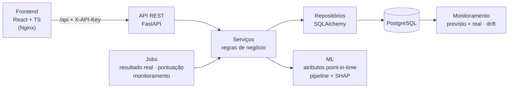
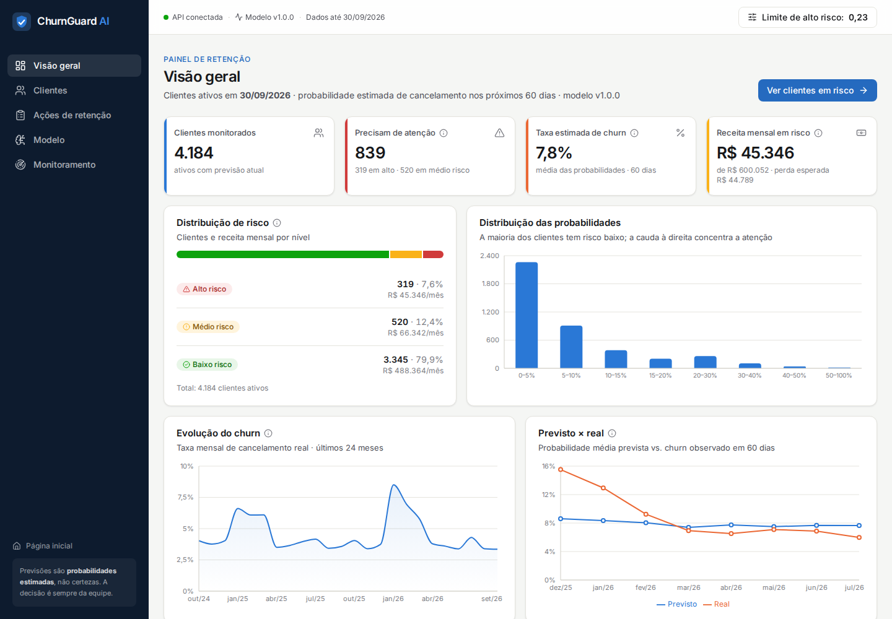
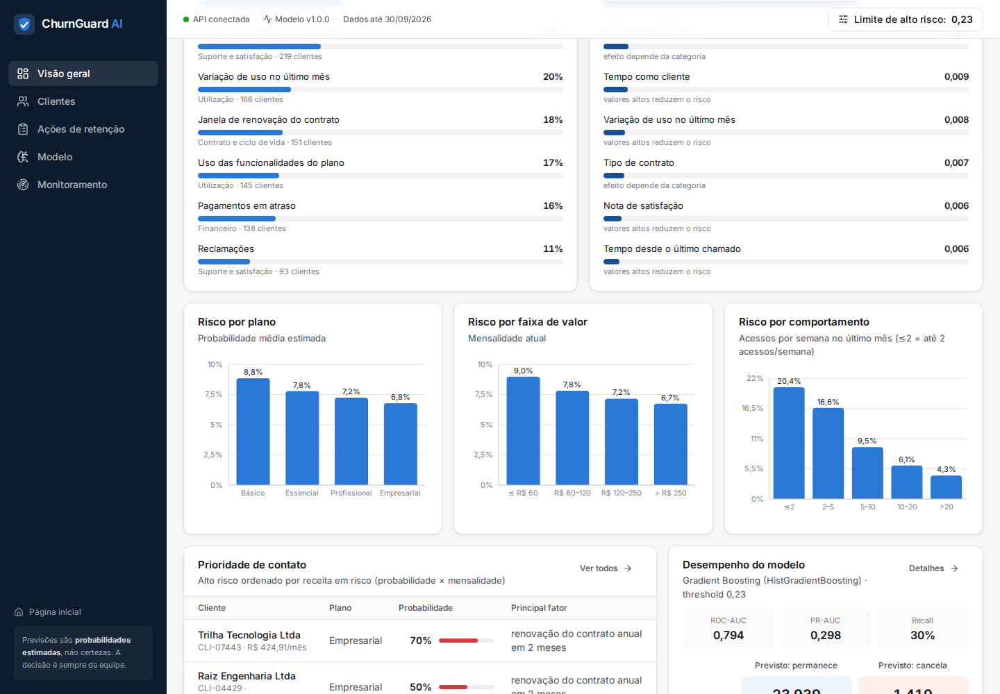
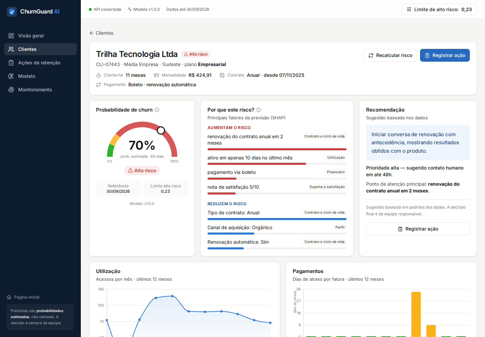
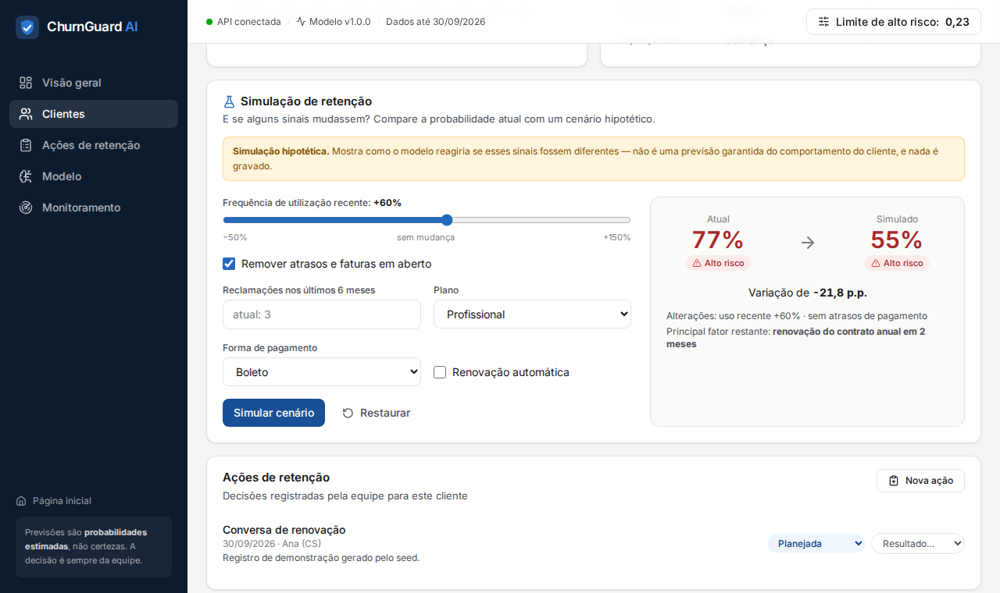
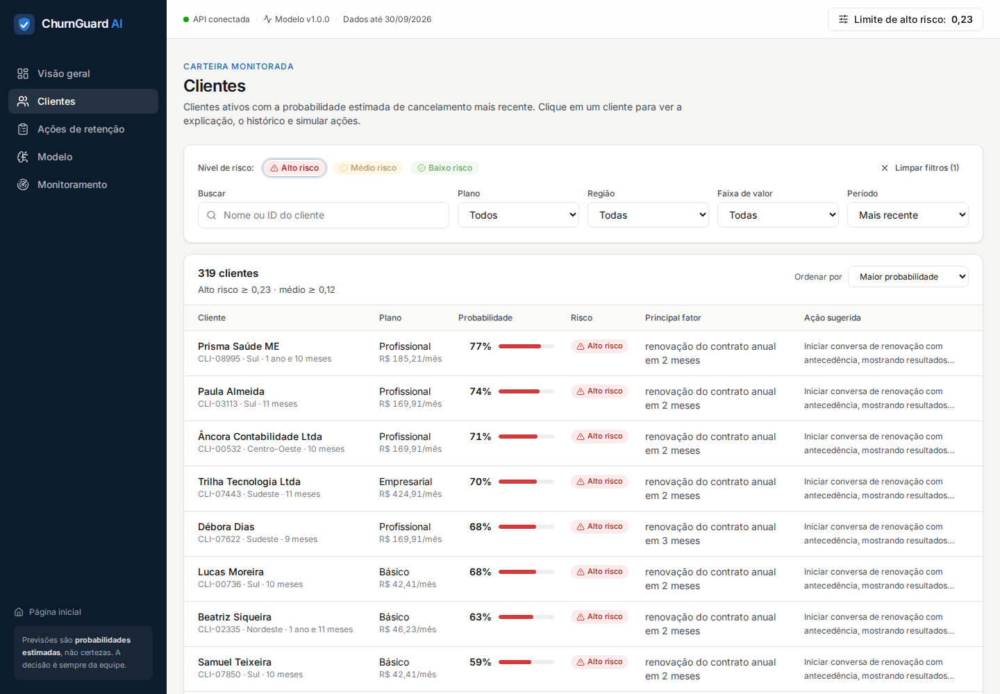
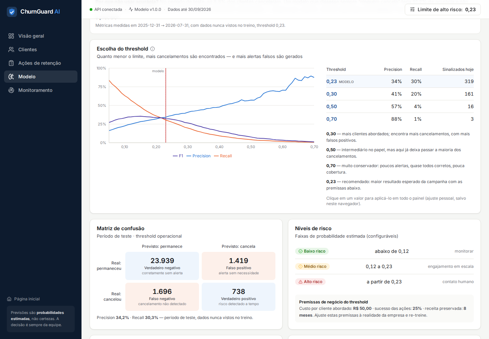
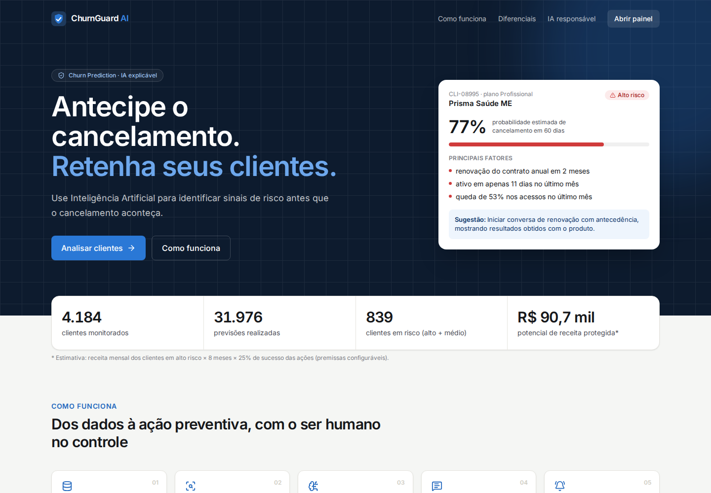
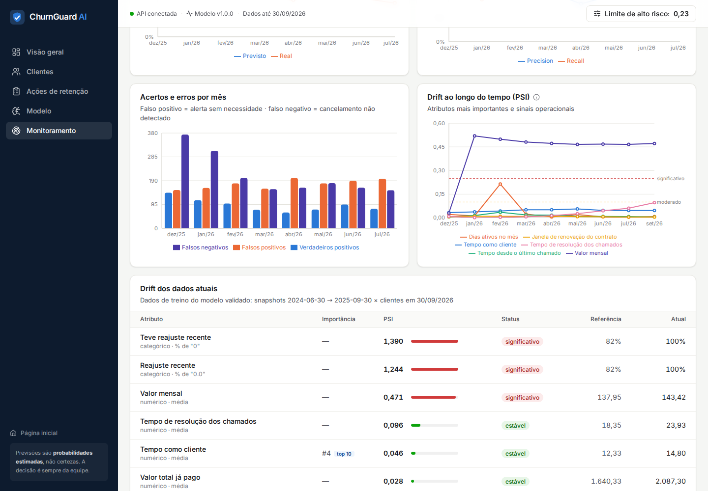

<div align="center">

# 🛡️ ChurnGuard AI

### Inteligência Artificial para prever cancelamentos antes que eles aconteçam.

*IA + Dados + Automação + Inteligência de Negócios*


</div>

> **Em vez de esperar o cliente cancelar, a empresa consegue identificar sinais de risco antecipadamente e agir de forma orientada por dados.**


> ✔️ Todos os requisitos da especificação foram conferidos item a item — veja a **[auditoria de requisitos](docs/auditoria.md)**.

## Sumário

1. [Problema](#1-problema) · 2. [Objetivo](#2-objetivo) · 3. [Solução](#3-solução) · 4. [Arquitetura](#4-arquitetura) ·
5. [Tecnologias](#5-tecnologias) · 6. [Dataset](#6-dataset) · 7. [Pipeline de Machine Learning](#7-pipeline-de-machine-learning) ·
8. [Engenharia de atributos](#8-engenharia-de-atributos) · 9. [Modelos testados](#9-modelos-testados) · 10. [Métricas](#10-métricas) ·
11. [Modelo escolhido](#11-modelo-escolhido-e-justificativa-técnica) · 12. [Explicabilidade](#12-explicabilidade) · 13. [API](#13-api) ·
14. [Dashboard](#14-dashboard) · 15. [Banco de dados](#15-banco-de-dados) · 16. [Monitoramento](#16-monitoramento) ·
17. [Como executar localmente](#17-como-executar-localmente) · 18. [Docker](#18-docker) · 19. [Limitações](#19-limitações) ·
20. [LGPD e ética](#20-lgpd-e-ética) · 21. [Próximos passos](#21-próximos-passos)

---

## 1. Problema

Empresas de assinatura (SaaS, planos mensais, serviços recorrentes) perdem receita quando clientes cancelam — e
quase sempre percebem só depois que o cancelamento aconteceu, quando a ação de retenção já é tardia.

> **"Quais clientes apresentam maior risco de cancelar e quais fatores estão contribuindo para esse risco?"**

## 2. Objetivo

- estimar a **probabilidade de cancelamento nos próximos 60 dias** para cada cliente ativo;
- classificar clientes em **baixo, médio e alto risco**, com limites configuráveis;
- explicar **por que** cada cliente está em risco, em linguagem de negócio;
- sugerir ações de retenção como **apoio à decisão humana**;
- permitir simular cenários ("e se o uso voltasse a crescer?");
- acompanhar o modelo em produção: **o que ele previu × o que realmente aconteceu**.

## 3. Solução

```text
Dados dos clientes → Tratamento → Feature Engineering → Modelo de ML → Probabilidade de churn
   → Classificação de risco → Explicação da previsão → Dashboard → Ação preventiva → Monitoramento do resultado
```

| Camada | Entrega |
|---|---|
| **Dados** | Dataset sintético realista com 57 meses de histórico de uso, faturas, chamados e pesquisas; base analítica *point-in-time* |
| **Machine Learning** | Gradient Boosting calibrado, validação temporal, threshold por valor de negócio, SHAP traduzido para o negócio |
| **API** | FastAPI com previsão avulsa e em lote, risco a partir do banco, simulação, ações de retenção, dashboard e monitoramento |
| **Banco** | PostgreSQL com migrations versionadas, previsões auditáveis e resultado real registrado após 60 dias |
| **Interface** | React + TypeScript: página inicial, visão geral, clientes, detalhe com simulação, modelo, ações, monitoramento |
| **Operação** | Docker Compose com um comando, jobs diários, alertas de drift e desempenho |

## 4. Arquitetura

Detalhes, diagramas de sequência e decisões: **[docs/architecture.md](docs/architecture.md)**



- **Separação de responsabilidades:** rotas tratam HTTP; serviços concentram as regras; repositórios isolam o SQL;
  o pacote `ml` não conhece banco nem API e pode ser usado em notebooks e jobs.
- **Mesmo código no treino e em produção:** o risco on-line usa a mesma função de atributos do treino, só com dados
  anteriores à data de referência — um teste garante que o resultado é idêntico ao da base de treino.

## 5. Tecnologias

| Área | Tecnologias | Por quê |
|---|---|---|
| Machine Learning | Python, Pandas, NumPy, scikit-learn, imbalanced-learn, SHAP | Pipeline serializável, CV temporal, explicação exata para árvores |
| Visualização | Matplotlib, Seaborn (relatórios) · Recharts (interface) | Mesma paleta de cores nos dois |
| Backend | FastAPI, Pydantic v2, SQLAlchemy 2.0, psycopg 3 | Contratos tipados e OpenAPI automático |
| Banco | PostgreSQL 16 (JSONB, views, constraints) | Previsões auditáveis e consultas analíticas |
| Frontend | React 19, TypeScript, Vite, Tailwind CSS v4, TanStack Query, lucide-react | Interface de produto, estados de carregamento/erro, acessível |
| Infraestrutura | Docker, Docker Compose, Nginx | Um comando para subir tudo; chave da API fora do navegador |
| Qualidade | pytest (ML + integração com PostgreSQL), vitest, Testing Library, GitHub Actions | 63 testes automatizados |

## 6. Dataset

Base **sintética realista** (`ml/src/data/generate_synthetic.py`, semente fixa) simulando 9.000 clientes de uma
empresa SaaS de jan/2022 a set/2026, com **traços latentes** (engajamento, fragilidade financeira, sensibilidade a
preço, satisfação) que evoluem com choques e geram o que uma empresa real registraria.

**Por que sintética?** Bases públicas de churn são fotografias estáticas, sem histórico de uso, chamados ou
pagamentos — sem isso não há atributos de *mudança de comportamento*, divisão temporal honesta nem monitoramento de drift.

| Tabela | Conteúdo | Registros |
|---|---|---:|
| `customers` | Cadastro, plano, contrato, forma de pagamento, canal | 9.025 (25 duplicatas propositais) |
| `usage_monthly` | Acessos, sessões, minutos, funcionalidades, dias ativos, último acesso | 117.184 |
| `payments` | Faturas, vencimento, pagamento, status | 109.732 |
| `tickets` | Chamados: categoria, tempo de resolução, avaliação | 47.410 |
| `surveys` | Pesquisa trimestral de satisfação (0–10) | 13.271 |
| `plans`, `price_adjustments` | Catálogo de planos e reajustes anuais | — |

A **base analítica** tem uma linha por *cliente ativo × fim de mês* (71.176 linhas, 26 datas de referência) com
`churn = 1` se o cliente cancelou nos 60 dias seguintes (8,4% em média). Problemas de qualidade foram injetados de
propósito (ausentes, idades impossíveis, outliers de integrações, duplicatas) e um *drift* operacional (suporte 35%
mais lento a partir de mar/2026).

Dicionário de dados e limitações: **[docs/dataset.md](docs/dataset.md)** · EDA completa: **[docs/eda.md](docs/eda.md)** · [notebook](ml/notebooks/01_eda.ipynb)

**Clientes não cancelam "do nada": o uso cai antes.**


<table>
<tr>
<td></td>
<td></td>
</tr>
<tr>
<td></td>
<td></td>
</tr>
</table>

## 7. Pipeline de Machine Learning

```text
FeatureEngineer (sem estado; seleciona só as colunas do modelo)
  → ColumnTransformer
       numéricas  : Winsorizer (p0,5–p99,5 do treino) → SimpleImputer(mediana) → StandardScaler*
       binárias   : SimpleImputer(moda)
       categóricas: SimpleImputer("Não informado") → OneHotEncoder(handle_unknown="ignore")
  → HistGradientBoostingClassifier
* padronização só para a Regressão Logística
```

| Etapa | Decisão |
|---|---|
| **Divisão temporal** | Treino: jun/2024–set/2025 · **intervalo de 60 dias descartado** · Teste: dez/2025–jul/2026. O rótulo olha 60 dias à frente; sem o intervalo, treino e teste se sobreporiam. |
| **Validação cruzada** | `TemporalGroupSplit`: 3 dobras com janela expansiva e intervalo — nunca treina com o futuro |
| **Prevenção de vazamento** | Agregações *point-in-time* (fatura paga depois da referência conta como "em aberto" naquele dia); `motivo_cancelamento` e `status` fora; tudo que aprende com os dados é ajustado só no treino de cada dobra |
| **Desbalanceamento** | `class_weight`, over/undersampling e SMOTE comparados **dentro das dobras** → nenhum melhora a ordenação e todos pioram a calibração → tratado no **threshold** |
| **Ajuste de hiperparâmetros** | `RandomizedSearchCV` com as dobras temporais, otimizando PR-AUC |
| **Threshold** | Escolhido com previsões *out-of-fold* do treino, pelo maior resultado financeiro esperado da campanha (premissas configuráveis) |
| **Teste** | Usado **uma única vez**, para reportar o desempenho |
| **Produção** | Re-treino com todos os dados rotulados, mesmos hiperparâmetros e thresholds |

Documentação completa, gerada automaticamente: **[docs/model.md](docs/model.md)** · [notebook](ml/notebooks/02_modelagem.ipynb)

## 8. Engenharia de atributos

Todas as transformações são **por linha e sem estado** (`ml/src/features/build_features.py`) — a mesma função é
usada no treino e na API.

| Grupo | Atributos |
|---|---|
| **Mudança de comportamento** | `variacao_uso` (3 meses vs. 3 anteriores), `variacao_uso_ultimo_mes`, `tendencia_uso` (inclinação em 6 meses), `meses_consecutivos_queda`, `variacao_minutos` |
| Utilização | `media_acessos_semana`, `taxa_utilizacao_funcionalidades` (normalizada pelo plano), `taxa_dias_ativos`, `minutos_por_sessao`, `dias_desde_ultimo_acesso` |
| Financeiro | `percentual_pagamentos_atrasados`, `dias_atraso_medio_6m`, `faturas_em_aberto`, `reajuste_pct_6m`, `valor_total_pago` |
| Suporte | `relacao_tickets_por_mes`, `aceleracao_tickets`, `proporcao_reclamacoes`, `tempo_desde_ultimo_chamado`, `avaliacao_media_6m`, `ultima_nota_satisfacao` |
| Ciclo de vida | `meses_ate_renovacao` (captura o pico de saída na renovação anual), `renovacao_proxima`, `cliente_novo` |
| Ausência informativa | `nunca_abriu_chamado`, `sem_pesquisa_satisfacao`, `sem_avaliacao_suporte`, `historico_curto` |

## 9. Modelos testados

| Modelo | CV PR-AUC (inicial → ajustado) | Teste ROC-AUC | Teste PR-AUC | Brier (teste) |
|---|---|---:|---:|---:|
| Regressão Logística (baseline interpretável) | 0,219 → 0,220 | 0,770 | 0,249 | 0,073 |
| Random Forest | 0,234 → 0,249 | 0,783 | 0,273 | 0,072 |
| **Gradient Boosting (HistGradientBoosting)** | 0,227 → **0,260** | **0,794** | **0,298** | **0,070** |


## 10. Métricas

Com ~9% de churn, um modelo que responde sempre "ninguém cancela" teria **91% de acurácia** e não encontraria
nenhum cliente em risco. Por isso a seleção usa **PR-AUC**, e a operação olha **recall** (cancelamentos
encontrados) e **precision** (alertas corretos).

| Métrica (teste, threshold 0,23) | Valor | Leitura |
|---|---:|---|
| ROC-AUC | **0,794** | Boa capacidade de ordenar clientes por risco |
| PR-AUC | **0,298** | 3,4× o acaso (taxa base 8,8%) |
| Precision | 34,2% | 1 em cada 3 sinalizados cancelaria |
| Recall | 30,3% | Encontra 3 em cada 10 cancelamentos com ~8% da base abordada |
| 10% de maior risco | churn real de **31,7%** | **3,6×** a média |
| Abordando 20% da base | encontra **57%** dos cancelamentos | Curva de ganho |
| Níveis de risco (teste) | Baixo 4,7% · Médio 19,1% · Alto 34,2% de churn real | Os níveis separam bem o risco |

<table>
<tr>
<td></td>
<td></td>
</tr>
</table>

**Threshold 0,23, não 0,50:** com 0,50, 96% dos cancelamentos passariam despercebidos. O limite é configurável na
API (`?threshold=`) e no painel, que mostra na hora precision, recall e quantos clientes seriam sinalizados.

## 11. Modelo escolhido e justificativa técnica

**Gradient Boosting (`HistGradientBoostingClassifier`) ajustado, sem reamostragem:**

- maior PR-AUC na validação cruzada (0,260 ± 0,008) **e** no teste (0,298);
- melhor calibração (menor Brier) — importante porque o produto **exibe a probabilidade**;
- captura interações (o efeito da renovação só existe para contratos anuais) e não-linearidades;
- árvores rasas e regularizadas (`max_leaf_nodes=8`, `l2_regularization≈3,5`) generalizam melhor para o período seguinte;
- nativo do scikit-learn: sem dependência extra em produção; SHAP exato com `TreeExplainer`.

A Regressão Logística permanece como baseline interpretável e confirma a direção dos efeitos.

## 12. Explicabilidade

| Nível | Técnica | Onde |
|---|---|---|
| Global | Permutation importance + SHAP (resumo) | `docs/model.md`, telas *Visão geral* e *Modelo* |
| Individual | SHAP por cliente → **frases de negócio** → sugestão de ação | API, tela do cliente |

```text
Cliente CLI-07443 — probabilidade estimada de cancelamento: 70% (Alto risco)
Resumo: O fator que mais contribuiu para aumentar o risco deste cliente foi: renovação do contrato anual
em 2 meses; também pesaram: ativo em apenas 10 dias no último mês e pagamento via boleto.
Fatores que aumentam o risco:
  • renovação do contrato anual em 2 meses
  • ativo em apenas 10 dias no último mês
  • pagamento via boleto
  • nota de satisfação 5/10
Sugestão: Iniciar conversa de renovação com antecedência, mostrando resultados obtidos com o produto.
⚠ Sugestão baseada em padrões dos dados. A decisão final é da equipe responsável.
```

Fatores estruturais (perfil, canal, contrato mensal) continuam visíveis, mas o **principal fator** e a
**recomendação** priorizam o que a empresa pode influenciar.

<table>
<tr>
<td></td>
<td></td>
</tr>
</table>

## 13. API

FastAPI com documentação OpenAPI/Swagger em `http://localhost:8000/docs` · Guia: **[docs/api.md](docs/api.md)** · [`docs/openapi.json`](docs/openapi.json)

| Método | Endpoint | Descrição |
|---|---|---|
| `POST` | `/api/v1/predict` | Probabilidade, risco, fatores, resumo e sugestão para os dados enviados (`?threshold=`, `?limite_medio=`) |
| `POST` | `/api/v1/predict/batch` | Previsão em lote (até 1.000 clientes) |
| `GET` | `/api/v1/customers/{id}/risk` | Risco calculado a partir do banco (point-in-time) e registrado |
| `GET` | `/api/v1/model/metrics` | Métricas no teste e matriz de confusão |
| `GET` | `/health` | Saúde da API, do banco e do modelo |
| `GET` | `/api/v1/customers` · `/customers/{id}` | Lista com filtros · perfil, histórico, previsões e ações |
| `POST` | `/api/v1/customers/{id}/simulate` | Simulação de retenção (hipotética; nada é gravado) |
| `GET/POST/PATCH` | `/api/v1/customers/{id}/actions` · `/api/v1/actions` | Ações de retenção |
| `GET` | `/api/v1/dashboard/summary` · `/api/v1/meta/*` | Dados do painel, trade-off de threshold, filtros |
| `GET/POST` | `/api/v1/monitoring/*` | Desempenho, drift, alertas e histórico de execuções |

Autenticação por `X-API-Key`; toda consulta a dados de um cliente é registrada em `access_log`.


## 14. Dashboard

| Tela | O que mostra |
|---|---|
| **Página inicial** | Proposta de valor, números ao vivo e um cliente real em alto risco com a explicação |
| **Visão geral** | KPIs (clientes, alto/médio/baixo risco, taxa estimada, receita em risco), distribuições, evolução do churn, previsto × real, fatores, risco por plano/valor/comportamento, prioridade de contato, matriz de confusão |
| **Clientes** | Tabela com filtros (risco, plano, região, faixa de valor, período, busca), ordenação e paginação. Em períodos passados, mostra o **resultado real em 60 dias** ao lado da previsão |
| **Cliente** | Medidor de probabilidade, resumo em linguagem de negócio, fatores (SHAP), recomendação, uso, pagamentos, chamados, evolução do risco, **simulação** e ações |
| **Modelo** | Métricas explicadas, **escolha do threshold**, matriz de confusão, níveis de risco, dados excluídos, limitações |
| **Ações de retenção** | Status e resultado das ações registradas, incluindo a decisão humana de **não agir** (“Revisão humana: sem ação”) |
| **Monitoramento** | Status do modelo, alertas, desempenho mensal, erros, drift (PSI), volume de previsões |

<table>
<tr><td></td><td></td></tr>
<tr><td></td><td></td></tr>
<tr><td></td><td></td></tr>
</table>

<p align="center"></p>

No topo de todas as telas, um controle ajusta os **limites de alto e médio risco** (os níveis são reclassificados
na hora, sem reprocessar o modelo). Ações confirmam o resultado com um aviso acessível.

Interface responsiva e acessível: risco sempre com ícone + texto, navegação por teclado, `aria-*`, estados de
carregamento, vazio e erro. Detalhes em [frontend/README.md](frontend/README.md).

## 15. Banco de dados

PostgreSQL 16 com schema versionado em [`database/migrations`](database/migrations) (SQL puro + executor próprio).

| Grupo | Tabelas |
|---|---|
| Operacional | `plans`, `price_adjustments`, `customers`, `usage_monthly`, `payments`, `tickets`, `surveys` |
| Machine Learning | `model_versions` (uma ativa), `predictions` (probabilidade, fatores, **entrada usada**, **resultado real**) |
| Decisão humana | `retention_actions` (vinculada à previsão que a motivou) |
| Operação e LGPD | `monitoring_runs`, `access_log` |
| Views | `v_latest_predictions`, `v_prediction_outcomes` (VP/FP/FN/VN), `v_monthly_model_performance` |

**"O que o modelo previu?" × "O que realmente aconteceu?"** — o job `update_outcomes` preenche `churn_real` das
previsões cujo horizonte de 60 dias terminou. Diagrama entidade-relacionamento em [docs/architecture.md](docs/architecture.md#4-banco-de-dados).

## 16. Monitoramento

Guia e política de re-treino: **[docs/monitoring.md](docs/monitoring.md)**

| O que | Como |
|---|---|
| Desempenho | Precision, recall, PR-AUC, ROC-AUC por mês, com o resultado real |
| Erros | Falsos positivos e negativos por mês |
| Calibração | Churn previsto × real |
| Data drift | PSI de cada atributo vs. dados de validação, cruzado com a importância |
| Alertas | ok / atenção / crítico com recomendação; job `monitor` sai com código 2 se crítico |

**O que ele encontrou:** o reajuste de 9% em jan/2026 gerou mais churn que o previsto (15,5% real × 8,6% previsto
em dez/2025) e os preços mudaram (PSI 0,47) — mas o recall recente (33%) segue acima do validado (30%): status
**atenção**, não crítico. O drift operacional do suporte aparece como tendência antes de cruzar o limite.

<table><tr>
<td></td>
<td></td>
</tr></table>

## 17. Como executar localmente

Requisitos: Python 3.11+, Node.js 20+ e PostgreSQL 16 (o mais simples: `docker compose up -d db`).
Todos os comandos na raiz do projeto. Atalhos equivalentes no [`Makefile`](Makefile).

```bash
# 1. Ambiente Python
python -m venv .venv
# Windows: .venv\Scripts\activate   |   Linux/macOS: source .venv/bin/activate
pip install -r ml/requirements.txt -r backend/requirements.txt
cp .env.example .env

# 2. Dados e ML (opcional: o modelo treinado já está versionado em ml/models)
python -m ml.src.data.generate_synthetic          # dataset sintético (~20 s)
python -m ml.src.data.build_analytical_base       # base analítica point-in-time
python -m ml.src.eda.run_eda                      # EDA → docs/eda.md
python -m ml.src.training.train                   # treino e seleção (~8 min em 2 CPUs; --fast ≈ 5 min)
python -m ml.src.evaluation.report                # docs/model.md + figuras
python -m ml.src.evaluation.fairness              # auditoria de viés

# 3. Banco e API
docker compose up -d db
python -m backend.app.db.bootstrap                # dados (se faltarem) + migrations + seed + monitoramento
python -m uvicorn backend.app.main:app --reload   # http://localhost:8000/docs

# 4. Frontend
cd frontend && npm install && npm run dev         # http://localhost:5173

# 5. Testes
python -m pytest ml/tests -q
docker compose exec db createdb -U churnguard churnguard_test && python -m pytest backend/tests -q
cd frontend && npm run test
```

## 18. Docker

```bash
cp .env.example .env            # opcional: troque senhas e chaves
docker compose up --build       # 1ª vez: ~3–5 min
```

| Endereço | O quê |
|---|---|
| http://localhost:8080 | Painel |
| http://localhost:8000/docs | Swagger (chave padrão de desenvolvimento: `painel-local-troque-esta-chave`) |

| Serviço | Papel |
|---|---|
| `db` | PostgreSQL 16 com volume persistente (porta só em `127.0.0.1`) |
| `bootstrap` | Executa uma vez: gera dados, migrations, seed, pontuação e 1º monitoramento — idempotente |
| `api` | FastAPI (usuário sem privilégios, healthcheck) |
| `frontend` | Nginx: SPA, cache, cabeçalhos de segurança e proxy da API com a chave injetada no servidor |
| `jobs` | Rotina diária sob demanda: `docker compose --profile jobs run --rm jobs` |

```bash
docker compose down        # para (mantém os dados)
docker compose down -v     # para e apaga banco e dados gerados
```

## 19. Limitações

- **Dados sintéticos:** os números demonstram o método; em dados reais o desempenho será diferente.
- **O modelo prioriza, não decide:** com precision de 34%, cerca de dois em cada três sinalizados não cancelariam.
- **Premissas financeiras** do threshold (custo R$ 50, sucesso 25%, 8 meses) são hipóteses a calibrar com campanhas reais.
- **Correlação não é causalidade:** recomendações são heurísticas; o efeito das ações precisa de grupo de controle.
- **Choques de preço** maiores que os do histórico (reajuste de 9%) foram subestimados — visível no monitoramento.
- **Pessoas físicas** têm churn subestimado (auditoria de viés) — tratado como próximo passo.
- **Granularidade mensal** e ausência de texto dos chamados limitam sinais mais rápidos ou qualitativos.

## 20. LGPD e ética

Documento completo: **[docs/lgpd.md](docs/lgpd.md)**

- **Probabilidade, não certeza** — "probabilidade estimada de cancelamento", nunca "este cliente vai cancelar".
- **Decisão humana** — o modelo sugere; a equipe decide e registra a ação. Nenhuma decisão automatizada sobre o cliente.
- **Minimização** — idade e região **fora do modelo** (sem sinal e com risco discriminatório), usadas só para auditoria.
- **Auditoria de viés** por região, idade e tipo de cliente, repetível a cada re-treino.
- **Rastreabilidade** — cada previsão guarda versão do modelo e dados usados; acessos a clientes ficam em `access_log`.
- **Segurança** — chave de API no servidor, banco não exposto, contêineres sem root, segredos fora do código.


## 21. Próximos passos

| Prioridade | Próximo passo | Por quê |
|---|---|---|
| Alta | Atributo de **sensibilidade a preço** e histórico de reajustes por cliente | Corrigir a subestimação após reajustes e em pessoas físicas |
| Alta | **Teste A/B** das ações de retenção (grupo de controle) | Medir efeito causal e calibrar as premissas do threshold |
| Média | Modelo de **uplift** (quem responde à ação, não só quem cancela) | Abordar quem pode ser retido, não só quem está em risco |
| Média | **Análise de sobrevivência** (tempo até o cancelamento) | Priorizar por urgência, não só por probabilidade |
| Média | **NLP nos chamados** (tema e sentimento) | Sinal qualitativo de insatisfação |
| Média | Registro de modelos e experimentos (MLflow) e re-treino agendado | Governança do ciclo de vida |
| Média | Autenticação de usuários (SSO) e perfis de acesso | Requisito de produção e LGPD |
| Baixa | Alertas por e-mail/Slack quando o monitoramento ficar crítico | Operação proativa |
| Baixa | Thresholds por segmento e orçamento de campanha | Adequar o esforço à capacidade de cada time |

---

### Estrutura do repositório

```text
churnguard-ai/
├── backend/                 # API FastAPI
│   ├── app/{api,core,db,models,schemas,repositories,services,jobs}
│   ├── tests/               # integração com PostgreSQL real
│   ├── Dockerfile
│   └── requirements.txt
├── ml/
│   ├── src/{data,eda,features,preprocessing,training,evaluation,explainability,monitoring,viz}
│   ├── notebooks/           # 01_eda, 02_modelagem (gerados por script)
│   ├── models/              # churn_model.joblib, metadados, perfil de referência (drift)
│   ├── reports/             # resultados de EDA, treino e auditoria
│   ├── tests/
│   └── requirements.txt
├── frontend/                # React 19 + TS + Vite + Tailwind v4 (+ Dockerfile e Nginx)
├── database/migrations/     # 001 schema · 002 views/triggers · 003 monitoramento · 004 revisão humana
├── docs/                    # dataset, eda, model, api, architecture, monitoring, lgpd, auditoria, publicação, openapi.json, imagens
├── .github/workflows/ci.yml # testes de ML, API (com PostgreSQL) e frontend
├── docker-compose.yml
├── Makefile
├── pyproject.toml           # configuração do ruff e do pytest
├── LICENSE
└── README.md
```

### Decisões de engenharia

| Decisão | Motivo |
|---|---|
| Grão cliente × mês com horizonte de 60 dias | Previsão **preventiva**, não descrição do passado |
| Agregações *point-in-time* e divisão temporal com intervalo | Evitar vazamento de informação do futuro |
| Seleção por PR-AUC; desbalanceamento tratado no threshold | Probabilidades calibradas e úteis para decisão |
| Threshold por valor de negócio, configurável | Conectar a métrica ao custo real da operação |
| Atributos sem estado e pipeline único serializado | Mesmo comportamento no treino, no teste e na API |
| Banco guarda fatos; previsões guardam a entrada usada | Auditoria e monitoramento sem recalcular |
| Principal fator = fator acionável | Recomendações que a equipe consegue executar |
| Drift cruzado com importância e desempenho | Evita alarmes falsos |
| Chave da API no Nginx; contêineres sem root | O navegador nunca recebe credenciais |
| Relatórios gerados por script | Nenhum número digitado à mão; tudo reexecutável |

---

<sub>Projeto de portfólio · Engenharia de Software + Inteligência Artificial · Dados 100% sintéticos, nenhum dado pessoal real · Licença MIT.</sub>
