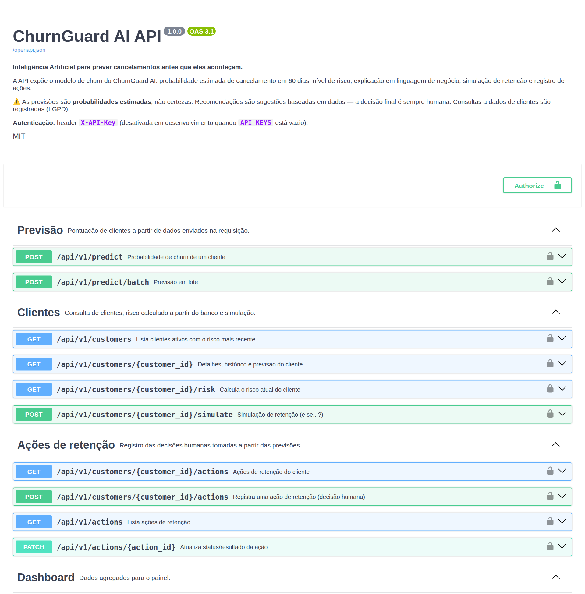

# API — ChurnGuard AI

API REST em **FastAPI** que expõe o modelo de churn, os dados de clientes e o registro de ações de retenção.
A especificação completa (OpenAPI 3) é gerada automaticamente:

| Recurso | URL (local) |
|---|---|
| Swagger UI (interativo) | http://localhost:8000/docs |
| ReDoc | http://localhost:8000/redoc |
| Especificação OpenAPI | http://localhost:8000/openapi.json · cópia versionada em [`docs/openapi.json`](openapi.json) |



## Convenções

- Prefixo versionado: **`/api/v1`**. `GET /health` também existe na raiz, sem autenticação, para orquestradores.
- JSON em UTF-8; datas no formato ISO (`2026-09-30`); nomes de campos em português, iguais aos do dataset.
- Probabilidades entre 0 e 1. **Sempre** acompanhadas do campo `aviso`: é uma estimativa, não uma certeza.
- Erros no formato `{"detail": "..."}`.

| Código | Quando |
|---|---|
| `200` / `201` | Sucesso / recurso criado |
| `401` | Chave de API ausente ou inválida |
| `404` | Cliente ou ação inexistente |
| `413` | Lote maior que `BATCH_MAX_SIZE` |
| `422` | Entrada inválida, cliente cancelado ou sem histórico suficiente |

## Autenticação

Header **`X-API-Key`**. No Docker Compose, o Nginx do painel injeta a chave nas chamadas à API (padrão
*backend-for-frontend*): o navegador nunca recebe a chave. As chaves ficam na variável `API_KEYS`, no formato `chave:usuario` separadas por
vírgula. O usuário associado à chave é gravado na tabela `access_log` sempre que dados de um cliente são
consultados ou alterados (rastreabilidade — LGPD). Com `API_KEYS` vazio, a API roda em modo desenvolvimento.

```bash
curl -H "X-API-Key: minha-chave" http://localhost:8000/api/v1/model/metrics
```

## Endpoints

| Método | Rota | Descrição |
|---|---|---|
| `GET` | `/health` | Saúde da API, do banco e do modelo |
| `POST` | `/api/v1/predict` | Probabilidade de churn para os dados enviados |
| `POST` | `/api/v1/predict/batch` | Previsão em lote (até 1.000 clientes) |
| `GET` | `/api/v1/customers` | Clientes ativos + risco mais recente (filtros, ordenação, paginação) |
| `GET` | `/api/v1/customers/{id}` | Perfil, histórico de uso/pagamentos/chamados, previsões e ações |
| `GET` | `/api/v1/customers/{id}/risk` | Calcula o risco **a partir do banco** e registra a previsão |
| `POST` | `/api/v1/customers/{id}/simulate` | Simulação "e se" (nada é gravado) |
| `GET` / `POST` | `/api/v1/customers/{id}/actions` | Lista / registra ação de retenção |
| `GET` | `/api/v1/actions` | Lista ações (filtro por status) |
| `PATCH` | `/api/v1/actions/{id}` | Atualiza status e resultado de uma ação |
| `GET` | `/api/v1/dashboard/summary` | Indicadores e séries para o dashboard (`?threshold=` e `?limite_medio=` reclassificam o risco) |
| `GET` | `/api/v1/meta/thresholds` | Trade-off precision × recall por threshold (previsões com resultado real) e clientes sinalizados hoje |
| `GET` | `/api/v1/meta/filtros` | Opções de filtros (planos, regiões, datas de referência, faixas de valor) |
| `GET` | `/api/v1/monitoring/summary` | Saúde do modelo: desempenho mensal, calibração, drift (PSI) e alertas |
| `POST` | `/api/v1/monitoring/run` | Executa o monitoramento e grava em `monitoring_runs` |
| `GET` | `/api/v1/monitoring/runs` | Histórico de execuções do monitoramento |
| `GET` | `/api/v1/model/info` | Versão, hiperparâmetros, thresholds, premissas, atributos |
| `GET` | `/api/v1/model/metrics` | Métricas no período de teste e matriz de confusão |

### `POST /api/v1/predict`

Recebe os dados agregados de um cliente (o mesmo contrato de entrada do modelo) e devolve probabilidade,
nível de risco, fatores e sugestão. Parâmetros opcionais `?threshold=0.30` e `?limite_medio=0.10` redefinem os limites de alto e médio risco
(o médio nunca fica acima do alto).
Se `customer_id` existir no banco, a previsão é registrada (`origem = 'api'`).

```bash
curl -X POST "http://localhost:8000/api/v1/predict?threshold=0.30" \
     -H "Content-Type: application/json" \
     -d @exemplo_cliente.json      # o exemplo completo está no Swagger
```

### `GET /api/v1/customers/{id}/risk`

Monta os atributos do cliente **a partir do banco**, usando a mesma função do treino (`build_snapshot`) e apenas
dados anteriores à data de referência. Parâmetros: `data_referencia` (padrão: hoje), `threshold` e `limite_medio`.

```json
{
  "customer_id": "CLI-07443",
  "data_referencia": "2026-09-30",
  "probabilidade": 0.6974,
  "nivel_risco": "Alto",
  "acima_do_threshold": true,
  "threshold": 0.23,
  "faixas_risco": { "medio": 0.12, "alto": 0.23 },
  "model_version": "1.0.0",
  "principal_fator": "renovação do contrato anual em 2 meses",
  "resumo": "O fator que mais contribuiu para aumentar o risco deste cliente foi: renovação do contrato anual em 2 meses; também pesaram: ativo em apenas 10 dias no último mês. Em sentido contrário, tipo de contrato (Anual) ajuda a reduzir o risco.",
  "categoria_principal": "contrato",
  "fatores_risco": [
    { "feature": "meses_ate_renovacao", "label": "Janela de renovação do contrato", "category_label": "Contrato e ciclo de vida",
      "impact": 1.514, "value": "2", "text": "renovação do contrato anual em 2 meses", "acionavel": true },
    { "feature": "taxa_dias_ativos", "label": "Dias ativos no mês", "category_label": "Utilização",
      "impact": 1.0751, "value": "33%", "text": "ativo em apenas 10 dias no último mês", "acionavel": true }
  ],
  "fatores_protecao": [
    { "feature": "ciclo_contrato", "label": "Tipo de contrato", "impact": -0.1509, "text": "Tipo de contrato: Anual", "acionavel": false }
  ],
  "recomendacao": {
    "prioridade": "Prioridade alta — sugerido contato humano em até 48h.",
    "acao_sugerida": "Iniciar conversa de renovação com antecedência, mostrando resultados obtidos com o produto.",
    "aviso": "Sugestão baseada em padrões dos dados. A decisão final é da equipe responsável."
  },
  "prediction_id": 31977,
  "aviso": "Probabilidade estimada a partir de padrões históricos. Não é certeza de cancelamento; a decisão sobre qualquer ação cabe à equipe responsável."
}
```

> `impact` é a contribuição SHAP (log-odds): positivo aumenta o risco. `acionavel = false` indica fatores que a
> empresa não muda com uma ação de retenção (ex.: canal de aquisição); a recomendação prioriza os acionáveis.
> `resumo` é a explicação em uma frase de negócio, pronta para exibir ao time de retenção.

### `POST /api/v1/customers/{id}/simulate`

```bash
curl -X POST http://localhost:8000/api/v1/customers/CLI-07443/simulate \
     -H "Content-Type: application/json" \
     -d '{"aumento_uso_percentual": 40, "remover_atrasos": true}'
```

```json
{
  "customer_id": "CLI-07443",
  "alteracoes_aplicadas": ["uso recente +40%", "sem atrasos de pagamento"],
  "atual":    { "probabilidade": 0.697, "nivel_risco": "Alto" },
  "simulado": { "probabilidade": 0.420, "nivel_risco": "Alto" },
  "variacao_pontos_percentuais": -27.79,
  "aviso": "Simulação hipotética: mostra como o modelo reagiria se esses sinais fossem diferentes. Não é uma previsão garantida do comportamento futuro do cliente."
}
```

Campos simuláveis: `aumento_uso_percentual` (−100 a +300; ajusta acessos, sessões, minutos, dias ativos),
`remover_atrasos`, `reclamacoes_6m`, `tickets_3m`, `tickets_6m`, `tickets_tecnicos_6m`, `plano` (atualiza preço e
funcionalidades de forma coerente), `forma_pagamento`, `renovacao_automatica`, `ciclo_contrato`,
`ultima_nota_satisfacao`, `dias_desde_ultimo_acesso`. Ao alterar só `tickets_3m`, os chamados de 6 meses (e
os técnicos/reclamações) são ajustados de forma coerente.

### `GET /api/v1/customers`

| Parâmetro | Exemplo | Descrição |
|---|---|---|
| `nivel_risco` | `?nivel_risco=Alto&nivel_risco=Médio` | Um ou mais níveis |
| `plano` | `Profissional` | Plano atual |
| `regiao` | `Sul` | Região (filtro de visualização; não é usada pelo modelo) |
| `valor_min`, `valor_max` | `100`, `250` | Faixa de mensalidade |
| `data_referencia` | `2026-01-31` | Período da previsão. Datas passadas mostram as previsões feitas naquele dia (inclusive de clientes que cancelaram depois), com `churn_real` = o que aconteceu em 60 dias |
| `busca` | `Prisma` | Nome ou ID |
| `ordenar` | `receita_em_risco` | `probabilidade` (padrão), `receita_em_risco`, `valor_mensal`, `nome` |
| `pagina`, `tamanho_pagina` | `1`, `25` | Paginação (máx. 200) |
| `threshold` | `0.30` | Limite de alto risco. O nível é recalculado a partir da probabilidade salva, sem reprocessar o modelo |
| `limite_medio` | `0.10` | Limite de médio risco (padrão do modelo: 0,12; limitado ao valor do alto) |

### Ações de retenção

```bash
# registrar
curl -X POST http://localhost:8000/api/v1/customers/CLI-07443/actions \
     -H "Content-Type: application/json" \
     -d '{"tipo_acao": "Conversa de renovação", "responsavel": "Ana (CS)"}'
# concluir com resultado
curl -X PATCH http://localhost:8000/api/v1/actions/25 \
     -H "Content-Type: application/json" -d '{"status": "Concluída", "resultado": "Retido"}'
```

A ação é vinculada automaticamente à previsão mais recente do cliente (`prediction_id`), permitindo medir depois
se as ações sobre clientes de alto risco funcionaram. Quando a equipe revisa o caso e decide **não agir**,
registra `"tipo_acao": "Revisão humana: sem ação"` — a decisão humana também fica documentada (migration 004).

## Jobs

| Comando | O que faz | Frequência sugerida |
|---|---|---|
| `python -m backend.app.jobs.score_customers` | Pontua todos os clientes ativos (origem `batch`) | Diária ou semanal |
| `python -m backend.app.jobs.update_outcomes` | Preenche `churn_real` das previsões cujo horizonte de 60 dias terminou | Diária |
| `python -m backend.app.jobs.monitor` | Desempenho, drift e alertas; grava em `monitoring_runs` (sai com código 2 se crítico) | Diária |

## Testes

```bash
python -m pytest backend/tests -q     # requer PostgreSQL (TEST_DATABASE_URL)
```

Os testes cobrem autenticação, validação de entrada, threshold configurável, filtros, auditoria de acesso,
simulação sem persistência (inclusive de chamados), ciclo de vida das ações, revisão humana, limites alto e
médio configuráveis, período histórico com resultado real, explicação em linguagem de negócio, dashboard e — principalmente — que **os atributos
montados a partir do banco em uma data passada reproduzem exatamente a base usada no treino** (sem vazamento).
