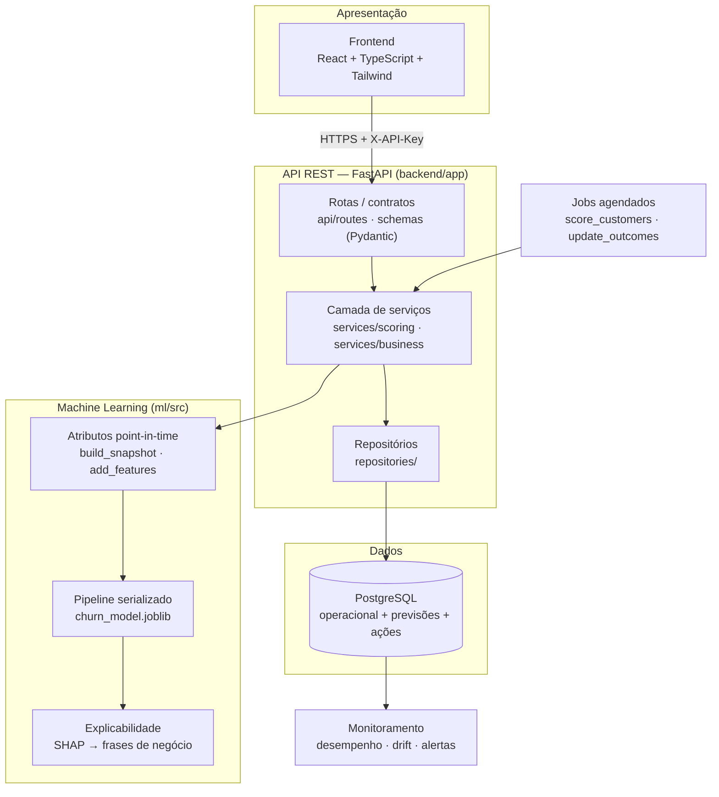
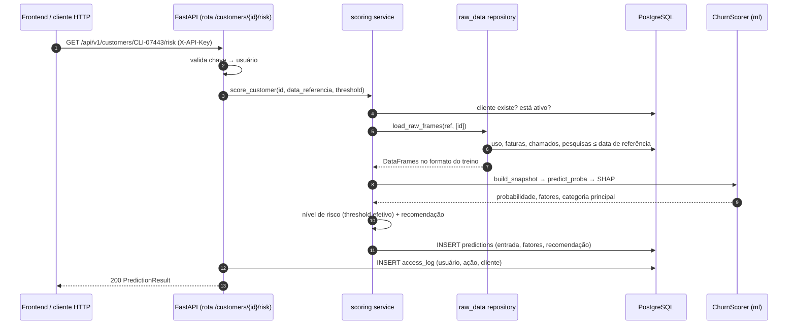
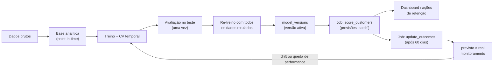
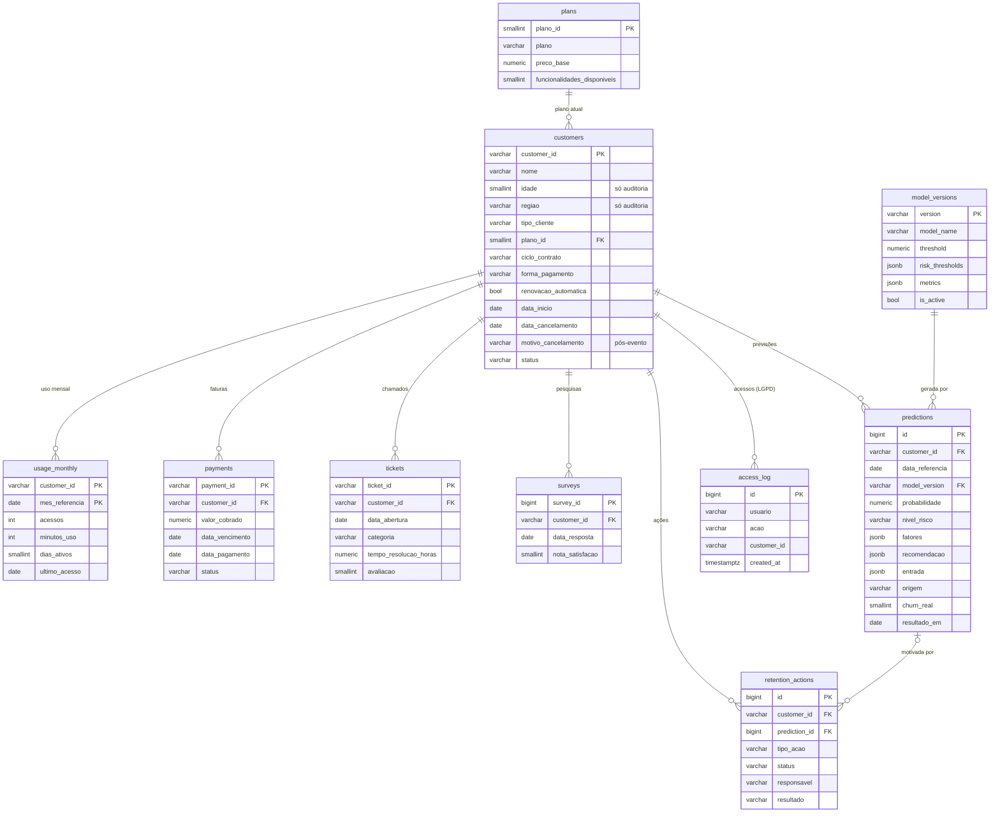
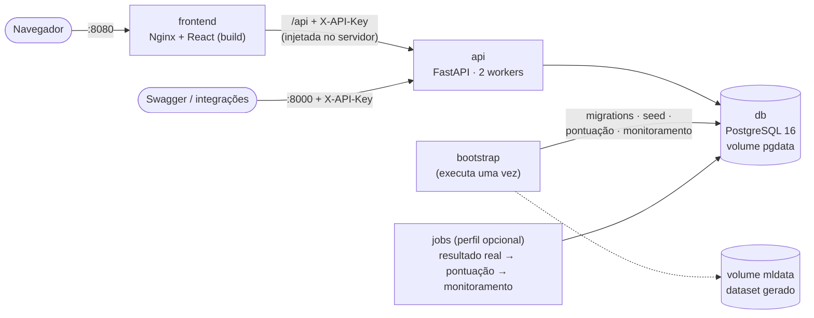

# Arquitetura — ChurnGuard AI

## 1. Visão geral



| Camada | Pasta | Responsabilidade | Não faz |
|---|---|---|---|
| Apresentação | `frontend/` | Telas, filtros, gráficos | Regra de negócio, cálculo de risco |
| API | `backend/app/api`, `schemas` | HTTP, validação de entrada/saída, códigos de erro, autenticação | Consultas SQL, lógica de ML |
| Serviços | `backend/app/services` | Regras de negócio: threshold efetivo, recomendação, simulação coerente, auditoria | Detalhes de HTTP |
| Repositórios | `backend/app/repositories` | Consultas SQL e mapeamento ORM | Regras de negócio |
| ML | `ml/src` | Atributos, modelo, explicação, métricas | Conhecer o banco ou a API |
| Persistência | `database/migrations` | Schema versionado, restrições, views analíticas | — |
| Jobs | `backend/app/jobs` | Pontuação em lote e registro do resultado real | — |
| Monitoramento | `ml/src/monitoring`, `backend/app/services/monitoring.py` | Desempenho, calibração, drift (PSI), alertas | Re-treinar automaticamente (decisão humana) |

O pacote `ml` **não depende** do backend: pode ser usado em notebooks, jobs ou outra API. O backend usa o `ml`
como biblioteca.

## 2. Fluxo de uma previsão a partir do banco



**Consistência treino × produção.** O risco calculado on-line usa exatamente as mesmas funções do treino
(`build_snapshot` e o pipeline serializado). Um teste automatizado garante que, para uma data passada,
a probabilidade calculada a partir do banco é idêntica à obtida com a base analítica usada no treino.

## 3. Ciclo de vida do modelo



## 4. Banco de dados

PostgreSQL 16. Schema versionado em [`database/migrations`](../database/migrations), aplicado por
`python -m backend.app.db.migrate` (cada arquivo em uma transação, registrado em `schema_migrations`).



### Decisões de modelagem

| Decisão | Motivo |
|---|---|
| Tabelas operacionais espelham os sistemas de origem (uso, faturas, chamados) | O banco guarda **fatos**; atributos do modelo são calculados na hora, com regras point-in-time |
| `predictions.entrada` (JSONB) guarda os atributos usados | Auditoria ("com quais dados o modelo decidiu?") e monitoramento de drift sem recalcular |
| `predictions.churn_real` + `resultado_em` | Responde **"o que o modelo previu?" × "o que realmente aconteceu?"** |
| `predictions.origem` (`batch`, `api`, `historico`) | Separa pontuação agendada, consultas on-line e previsões históricas do período de teste |
| `model_versions` com índice único parcial em `is_active` | Garante uma única versão ativa; previsões sempre rastreáveis à versão |
| `retention_actions.prediction_id` | Liga a decisão humana à previsão que a motivou (medir efetividade das ações) |
| `access_log` | Rastreabilidade de quem consultou dados de qual cliente (LGPD) |
| `CHECK` constraints (domínios, `idade 18–100`, `status` × `data_cancelamento`) | Qualidade garantida no banco, não só na aplicação |
| `motivo_cancelamento` documentado como pós-evento | Evita que alguém o use como atributo no futuro (vazamento) |

### Views

| View | Uso |
|---|---|
| `v_latest_predictions` | Previsão mais recente de cada cliente (tabela do dashboard) |
| `v_prediction_outcomes` | Cada previsão classificada como VP, FP, FN, VN ou "Aguardando" |
| `v_monthly_model_performance` | Previsto × real e matriz de confusão por data de referência |

Tabela `monitoring_runs` (migration 003): cada execução do monitoramento com status, alertas, desempenho e drift.
Migration 004: novo tipo de ação `Revisão humana: sem ação`, para registrar quando a equipe decide não agir.

## 5. Implantação com Docker



| Serviço | Imagem | Papel | Depende de |
|---|---|---|---|
| `db` | `postgres:16-alpine` | Banco, volume persistente, porta só em `127.0.0.1` | — |
| `bootstrap` | `churnguard-api` | Gera dados (se faltarem), migrations, seed, 1º monitoramento; idempotente | `db` saudável |
| `api` | `churnguard-api` | FastAPI (usuário sem privilégios, healthcheck em `/health`) | `bootstrap` concluído |
| `frontend` | `churnguard-frontend` | Nginx: SPA, cache de assets, cabeçalhos de segurança, proxy da API com a chave | `api` saudável |
| `jobs` | `churnguard-api` | Rotina diária sob demanda (`--profile jobs`) | `db` saudável |

## 6. Segurança e privacidade (resumo)

- Autenticação por `X-API-Key` em toda a API versionada; `/health` público.
- Registro de acesso a dados de clientes (`access_log`) com o usuário da chave.
- Minimização: listagens e detalhes não expõem idade; região é usada apenas como filtro de visualização.
- CORS restrito às origens configuradas; métodos limitados a GET/POST/PATCH.
- Segredos via variáveis de ambiente (`.env`, nunca versionado — ver `.env.example`).
- Detalhes em [`docs/lgpd.md`](lgpd.md).

## 7. Estrutura do backend

```text
backend/
├── app/
│   ├── main.py              # FastAPI: middlewares, routers, OpenAPI, carga do modelo no startup
│   ├── core/                # config (pydantic-settings), segurança (API key)
│   ├── db/                  # sessão, executor de migrations, seed, bootstrap
│   ├── models/entities.py   # ORM (SQLAlchemy 2.0)
│   ├── schemas/schemas.py   # contratos Pydantic (entrada/saída)
│   ├── repositories/        # SQL: raw_data (formato do ML) e repositórios de domínio
│   ├── services/            # scoring (modelo + banco) e business (clientes, dashboard, ações)
│   ├── api/routes/          # predict, customers, operations (actions, dashboard), system
│   ├── services/monitoring.py  # desempenho, calibração, drift (PSI), alertas
│   └── jobs/                # score_customers, update_outcomes, monitor
├── tests/                   # testes de integração com PostgreSQL real
├── Dockerfile
└── requirements.txt
```
