# Análise Exploratória de Dados (EDA)

> Relatório gerado automaticamente por `python -m ml.src.eda.run_eda`.
> Os números abaixo são recalculados a cada execução — não há valores digitados à mão.

## 1. Escopo e unidade de análise

A unidade de análise é **cliente × data de referência** (snapshot mensal). Cada linha responde:

> *Com o que a empresa sabia no fim do mês, esse cliente cancelou nos 60 dias seguintes?*

| Item | Valor |
|---|---:|
| Registros (cliente × mês) | 71.176 |
| Variáveis | 42 |
| Clientes distintos | 6.856 |
| Datas de referência | 26 (jun/2024 → jul/2026) |
| Taxa média de churn em 60 dias | **8,4%** |
| Proporção permaneceu : cancelou | 10,9 : 1 |

A EDA é **descritiva**. Qualquer decisão de tratamento que "aprenda" com os dados (limites de outlier,
médias para imputação, etc.) será calculada **apenas no conjunto de treino** (ver `docs/model.md`), para evitar vazamento.

## 2. Qualidade dos dados brutos

| tabela | registros | colunas | duplicatas_exatas | células_ausentes_% |
|---|---:|---:|---:|---:|
| customers | 9.025 | 14 | 25 | 6,91 |
| plans | 4 | 5 | 0 | 0,00 |
| usage_monthly | 117.184 | 8 | 0 | 0,36 |
| payments | 109.732 | 7 | 0 | 0,03 |
| tickets | 47.410 | 7 | 0 | 6,42 |
| surveys | 13.271 | 3 | 0 | 0,00 |
| price_adjustments | 4 | 3 | 0 | 0,00 |

Problemas encontrados e decisão:

| Problema | Onde | Tratamento previsto |
|---|---|---|
| 25 linhas duplicadas | `customers` (falha de integração com CRM) | Remoção de duplicatas exatas na ingestão |
| Idade ausente (~3%) | `customers.idade` | Mantida só para auditoria (não entra no modelo, ver seção 8) |
| 12 idades impossíveis (0, 1, 112, 120, 150) | `customers.idade` | Converter para ausente (validação de domínio 18–100) |
| Região ausente (~0,5%) | `customers.regiao` | Mantida só para auditoria de viés (não entra no modelo) |
| Minutos de uso extremos (~0,2%) | `usage_monthly.minutos_uso` | Winsorização no p99 do treino (integrações/bots) |
| Ausência estrutural | reajuste, avaliação, satisfação, último chamado | Imputação + *flag* indicadora ("nunca abriu chamado" é informação) |

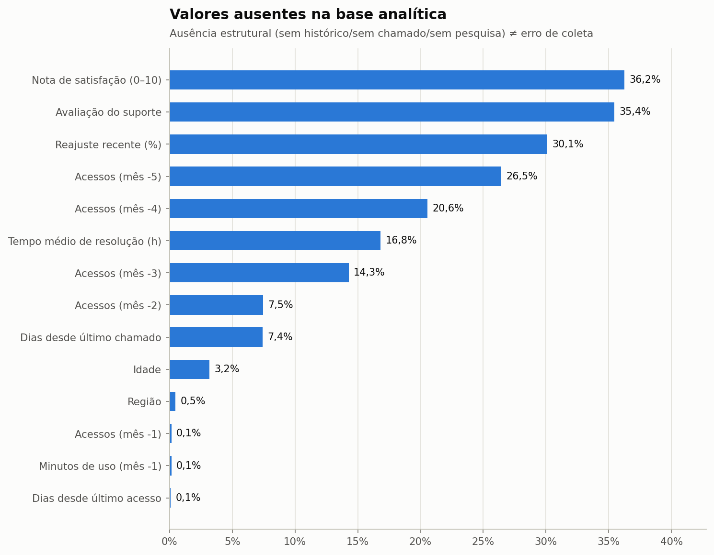

### Perfil das variáveis da base analítica

Ver tipos, ausentes e cardinalidade de todas as colunas

| variável | tipo | ausentes | ausentes_% | valores_unicos |
|---|---|---:|---:|---:|
| customer_id | str | 0 | 0,00 | 6.856 |
| data_referencia | datetime64[us] | 0 | 0,00 | 26 |
| idade | float64 | 2.267 | 3,19 | 65 |
| regiao | str | 337 | 0,47 | 5 |
| tipo_cliente | str | 0 | 0,00 | 3 |
| plano | str | 0 | 0,00 | 4 |
| funcionalidades_disponiveis | int64 | 0 | 0,00 | 4 |
| ciclo_contrato | str | 0 | 0,00 | 2 |
| forma_pagamento | str | 0 | 0,00 | 4 |
| renovacao_automatica | int64 | 0 | 0,00 | 2 |
| canal_aquisicao | str | 0 | 0,00 | 5 |
| tempo_cliente_meses | float64 | 0 | 0,00 | 538 |
| acessos_m1 | float64 | 0 | 0,00 | 627 |
| acessos_m2 | float64 | 105 | 0,15 | 617 |
| acessos_m3 | float64 | 5.311 | 7,46 | 611 |
| acessos_m4 | float64 | 10.160 | 14,27 | 605 |
| acessos_m5 | float64 | 14.643 | 20,57 | 596 |
| acessos_m6 | float64 | 18.827 | 26,45 | 584 |
| sessoes_m1 | int64 | 0 | 0,00 | 793 |
| minutos_uso_m1 | int64 | 0 | 0,00 | 7.334 |
| funcionalidades_usadas_m1 | int64 | 0 | 0,00 | 21 |
| dias_ativos_m1 | int64 | 0 | 0,00 | 31 |
| minutos_uso_m2 | float64 | 105 | 0,15 | 7.285 |
| dias_desde_ultimo_acesso | float64 | 60 | 0,08 | 121 |
| faturas_6m | int64 | 0 | 0,00 | 6 |
| faturas_atrasadas_6m | int64 | 0 | 0,00 | 7 |
| dias_atraso_medio_6m | float64 | 0 | 0,00 | 304 |
| faturas_em_aberto | float64 | 0 | 0,00 | 4 |
| valor_total_pago | float64 | 0 | 0,00 | 6.332 |
| qtd_cobrancas_total | int64 | 0 | 0,00 | 55 |
| valor_mensal | float64 | 0 | 0,00 | 80 |
| reajuste_pct_6m | float64 | 21.430 | 30,11 | 7 |
| tickets_3m | int64 | 0 | 0,00 | 13 |
| tickets_6m | int64 | 0 | 0,00 | 14 |
| tickets_tecnicos_6m | int64 | 0 | 0,00 | 9 |
| reclamacoes_6m | int64 | 0 | 0,00 | 8 |
| tempo_medio_resolucao_h_6m | float64 | 11.971 | 16,82 | 6.748 |
| avaliacao_media_6m | float64 | 25.222 | 35,44 | 55 |
| dias_desde_ultimo_chamado | float64 | 5.286 | 7,43 | 615 |
| ultima_nota_satisfacao | float64 | 25.797 | 36,24 | 9 |
| churn | int64 | 0 | 0,00 | 2 |

### Estatísticas descritivas

Ver estatísticas descritivas

| variável | mean | std | min | 25% | 50% | 75% | max |
|---|---|---|---|---|---|---|---|
| data_referencia | 2025-09-04 19:26:48.811958 | — | 2024-06-30 00:00:00 | 2025-02-28 00:00:00 | 2025-09-30 00:00:00 | 2026-03-31 00:00:00 | 2026-07-31 00:00:00 |
| Idade | 39,37 | 11,49 | 0,00 | 31,00 | 39,00 | 47,00 | 150,00 |
| funcionalidades_disponiveis | 10,06 | 4,47 | 5,00 | 5,00 | 9,00 | 14,00 | 20,00 |
| Renovação automática | 0,71 | 0,46 | 0,00 | 0,00 | 1,00 | 1,00 | 1,00 |
| Tempo de cliente (meses) | 13,18 | 10,69 | 1,00 | 4,70 | 9,90 | 19,00 | 54,80 |
| Acessos no mês | 70,60 | 69,18 | 0,00 | 30,00 | 50,00 | 85,00 | 1.096,00 |
| Acessos (mês -1) | 68,91 | 68,94 | 0,00 | 29,00 | 49,00 | 84,00 | 1.096,00 |
| Acessos (mês -2) | 69,63 | 69,46 | 0,00 | 30,00 | 49,00 | 84,00 | 1.096,00 |
| Acessos (mês -3) | 70,21 | 69,79 | 0,00 | 30,00 | 50,00 | 85,00 | 1.096,00 |
| Acessos (mês -4) | 70,66 | 69,90 | 0,00 | 30,00 | 50,00 | 86,00 | 1.096,00 |
| Acessos (mês -5) | 70,91 | 69,87 | 0,00 | 30,00 | 50,00 | 86,00 | 1.096,00 |
| Sessões no mês | 93,54 | 93,22 | 0,00 | 40,00 | 66,00 | 112,00 | 1.627,00 |
| Minutos de uso no mês | 1.608,04 | 3.184,56 | 0,00 | 510,00 | 947,00 | 1.797,25 | 230.359,00 |
| Funcionalidades usadas | 5,56 | 3,47 | 0,00 | 3,00 | 5,00 | 8,00 | 20,00 |
| Dias ativos no mês | 20,00 | 5,83 | 0,00 | 17,00 | 21,00 | 24,00 | 31,00 |
| Minutos de uso (mês -1) | 1.569,85 | 3.160,77 | 0,00 | 483,00 | 921,00 | 1.761,00 | 230.359,00 |
| Dias desde último acesso | 3,77 | 8,79 | 0,00 | 0,00 | 1,00 | 3,00 | 214,00 |
| faturas_6m | 5,10 | 1,56 | 1,00 | 5,00 | 6,00 | 6,00 | 6,00 |
| Faturas atrasadas (6m) | 0,56 | 0,84 | 0,00 | 0,00 | 0,00 | 1,00 | 6,00 |
| Atraso médio (dias, 6m) | 1,33 | 2,96 | 0,00 | 0,00 | 0,00 | 1,50 | 42,33 |
| Faturas em aberto | 0,04 | 0,20 | 0,00 | 0,00 | 0,00 | 0,00 | 3,00 |
| Valor total pago (R$) | 1.794,92 | 2.407,38 | 0,00 | 399,80 | 999,50 | 2.180,41 | 28.221,18 |
| qtd_cobrancas_total | 13,03 | 10,70 | 1,00 | 5,00 | 10,00 | 19,00 | 55,00 |
| Valor mensal (R$) | 140,45 | 114,87 | 42,41 | 54,39 | 99,90 | 181,81 | 648,92 |
| Reajuste recente (%) | 0,03 | 0,04 | 0,00 | 0,00 | 0,00 | 0,07 | 0,09 |
| Chamados (3m) | 1,10 | 1,16 | 0,00 | 0,00 | 1,00 | 2,00 | 12,00 |
| Chamados (6m) | 2,01 | 1,61 | 0,00 | 1,00 | 2,00 | 3,00 | 13,00 |
| tickets_tecnicos_6m | 0,53 | 0,82 | 0,00 | 0,00 | 0,00 | 1,00 | 8,00 |
| Reclamações (6m) | 0,33 | 0,68 | 0,00 | 0,00 | 0,00 | 0,00 | 7,00 |
| Tempo médio de resolução (h) | 19,15 | 19,09 | 0,30 | 7,90 | 14,10 | 23,92 | 677,90 |
| Avaliação do suporte | 4,13 | 0,73 | 1,00 | 4,00 | 4,00 | 5,00 | 5,00 |
| Dias desde último chamado | 79,50 | 82,75 | 0,00 | 22,00 | 54,00 | 109,00 | 837,00 |
| Nota de satisfação (0–10) | 7,60 | 1,49 | 2,00 | 7,00 | 8,00 | 9,00 | 10,00 |
| Churn (alvo) | 0,08 | 0,28 | 0,00 | 0,00 | 0,00 | 0,00 | 1,00 |

## 3. Variável-alvo

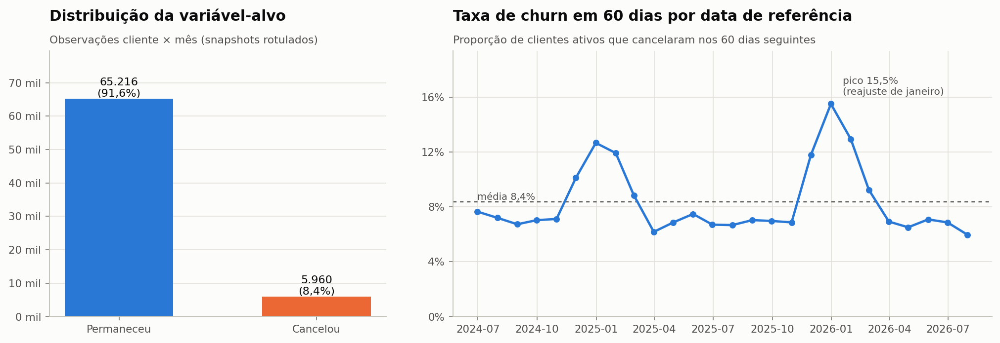

- A base é **desbalanceada**: 8,4% de churn. Um modelo que responda sempre "não cancela"
  teria **91,6% de acurácia** e não encontraria nenhum cliente em risco — por isso a acurácia
  não será a métrica principal.
- A taxa varia no tempo e tem **picos após o reajuste anual de janeiro**, sinal de que os dados têm dinâmica
  temporal e que a divisão treino/teste precisa respeitar o tempo.

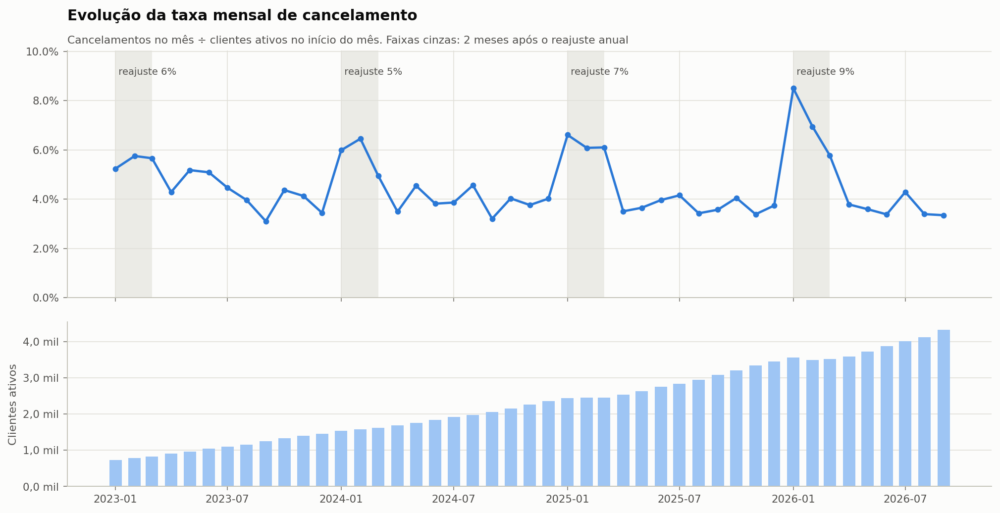

Taxa mensal média de cancelamento: **4,5%**; pico em 01/2026 (8,5%).

## 4. Churn por dimensão de negócio

### Plano e preço
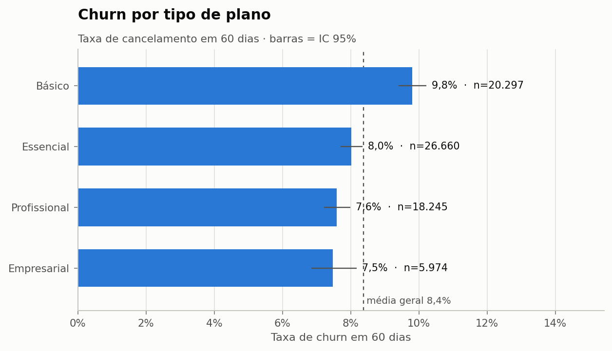
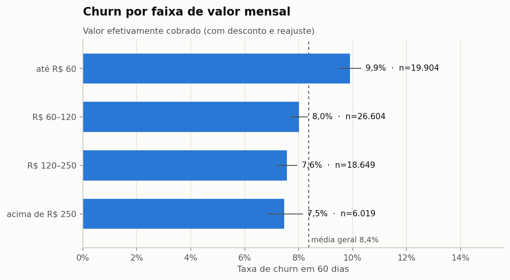

O plano Básico cancela **9,8%** contra **7,5%** no Empresarial.
Preço mais alto **não** significa mais churn: planos maiores atendem empresas com uso mais enraizado.

### Tempo de relacionamento
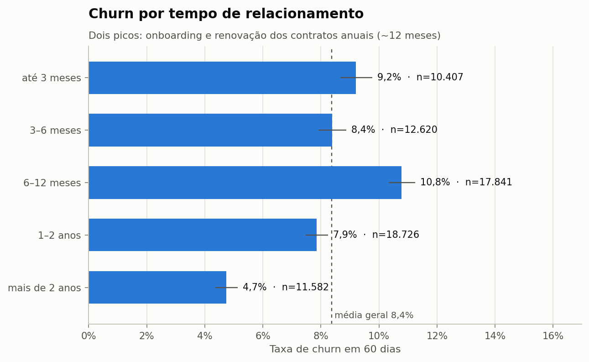

O risco cai com o tempo de casa (**4,7%** acima de 2 anos), mas há dois momentos críticos:
o **onboarding** (até 3 meses: **9,2%**) e a faixa de **6–12 meses** (**10,8%**), quando
os contratos anuais chegam à renovação. A interação *tempo de casa × tipo de contrato* é um atributo candidato
("meses até a renovação").

### Frequência de utilização
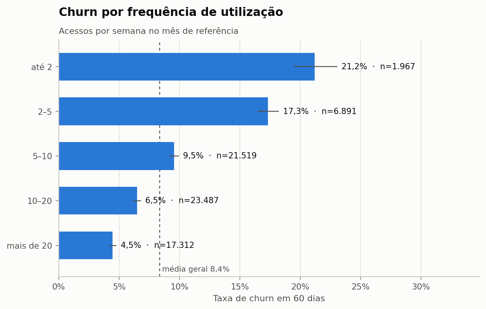

Quem acessa até 2 vezes por semana tem churn de **21,2%**, contra **4,5%**
de quem acessa mais de 20 vezes.

### Mudança de comportamento — o sinal mais importante
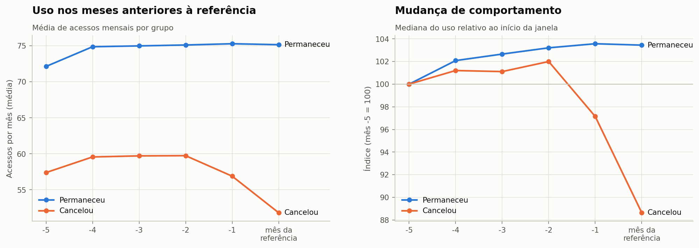

A mediana da variação de uso (últimos 3 meses vs. 3 anteriores) é **-1,5%** para quem cancelou
e **5,4%** para quem permaneceu. Clientes não cancelam "do nada": o uso cai antes.
Isso justifica criar atributos de **tendência** na engenharia de atributos, e não apenas fotos do mês atual.

### Relacionamento e suporte
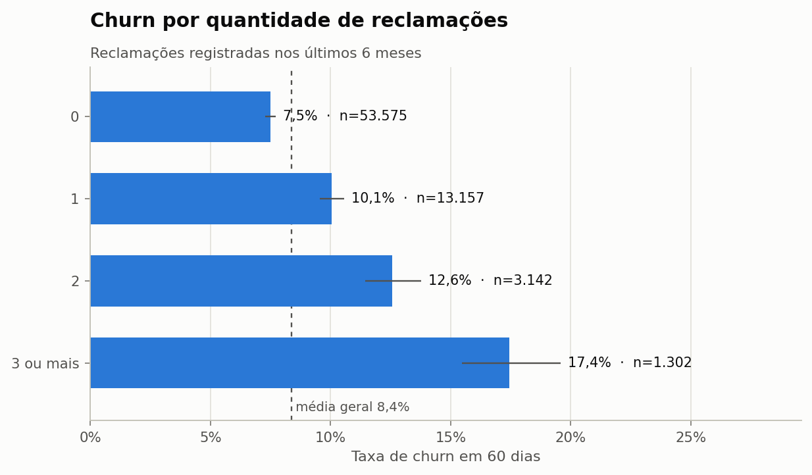

Sem reclamações: **7,5%**; com 3 ou mais: **17,4%**.

### Pagamento
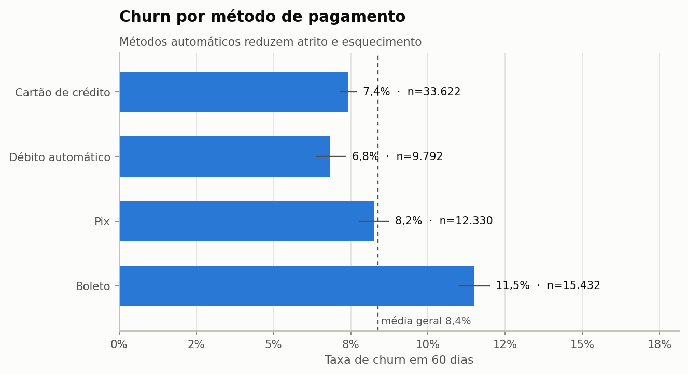
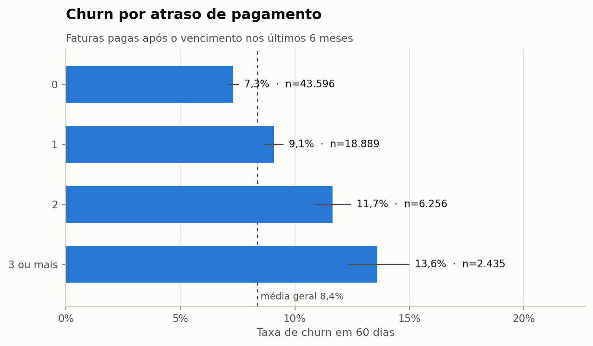

Boleto: **11,5%** vs. cartão: **7,4%**. Sem atrasos: **7,3%**;
3+ atrasos em 6 meses: **13,6%**.

### Contrato, renovação e canal
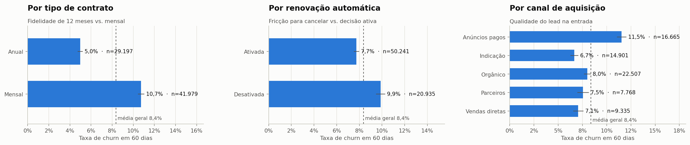

## 5. Comparação entre quem cancelou e quem permaneceu

| variável | média_permaneceu | média_cancelou | mediana_permaneceu | mediana_cancelou | diferença_% |
|---|---:|---:|---:|---:|---:|
| Dias desde último acesso | 3,47 | 7,09 | 1,00 | 2,00 | 104,40 |
| Reclamações (6m) | 0,32 | 0,48 | 0,00 | 0,00 | 50,40 |
| Faturas atrasadas (6m) | 0,54 | 0,72 | 0,00 | 0,00 | 33,60 |
| Acessos no mês | 72,57 | 48,94 | 52,00 | 34,00 | -32,60 |
| Acessos por semana | 16,76 | 11,30 | 12,01 | 7,85 | -32,60 |
| Funcionalidades usadas | 5,68 | 4,26 | 5,00 | 4,00 | -24,90 |
| Chamados (3m) | 1,09 | 1,32 | 1,00 | 1,00 | 21,30 |
| Variação de uso (3m vs 3m) | 0,29 | 0,24 | 0,05 | -0,02 | -18,70 |
| Dias ativos no mês | 20,30 | 16,62 | 21,00 | 17,00 | -18,10 |
| Tempo de cliente (meses) | 13,34 | 11,40 | 10,10 | 9,40 | -14,50 |
| Nota de satisfação (0–10) | 7,64 | 7,18 | 8,00 | 7,00 | -6,00 |
| Tempo médio de resolução (h) | 19,06 | 20,10 | 14,00 | 14,90 | 5,40 |
| Valor mensal (R$) | 140,96 | 134,83 | 99,90 | 99,90 | -4,40 |
| Idade | 39,35 | 39,57 | 39,00 | 39,00 | 0,60 |

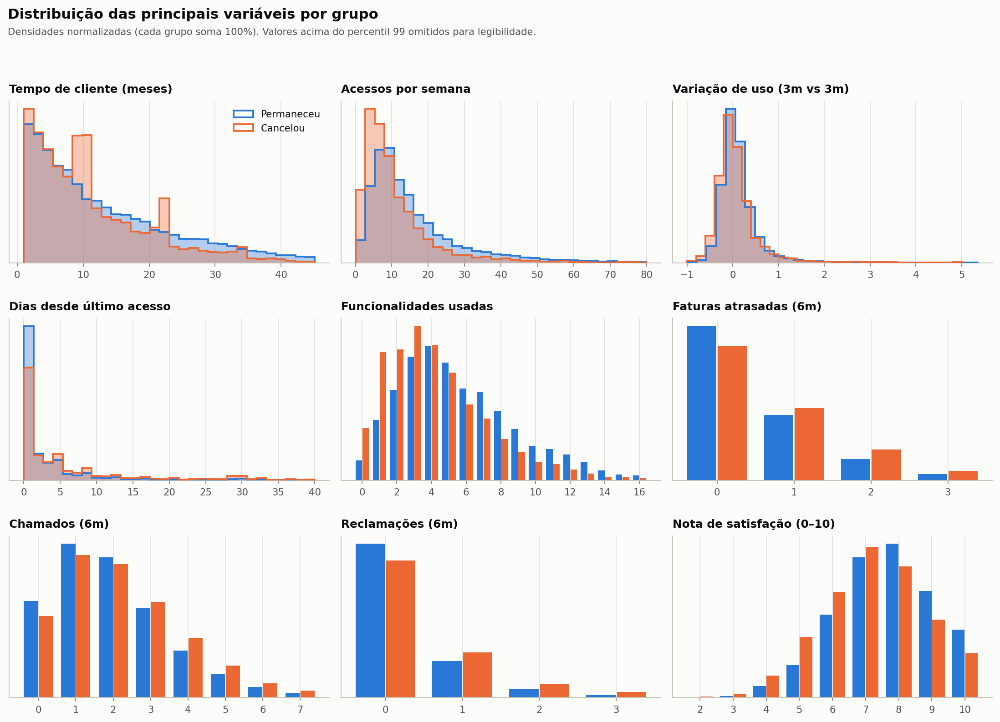

## 6. Correlação

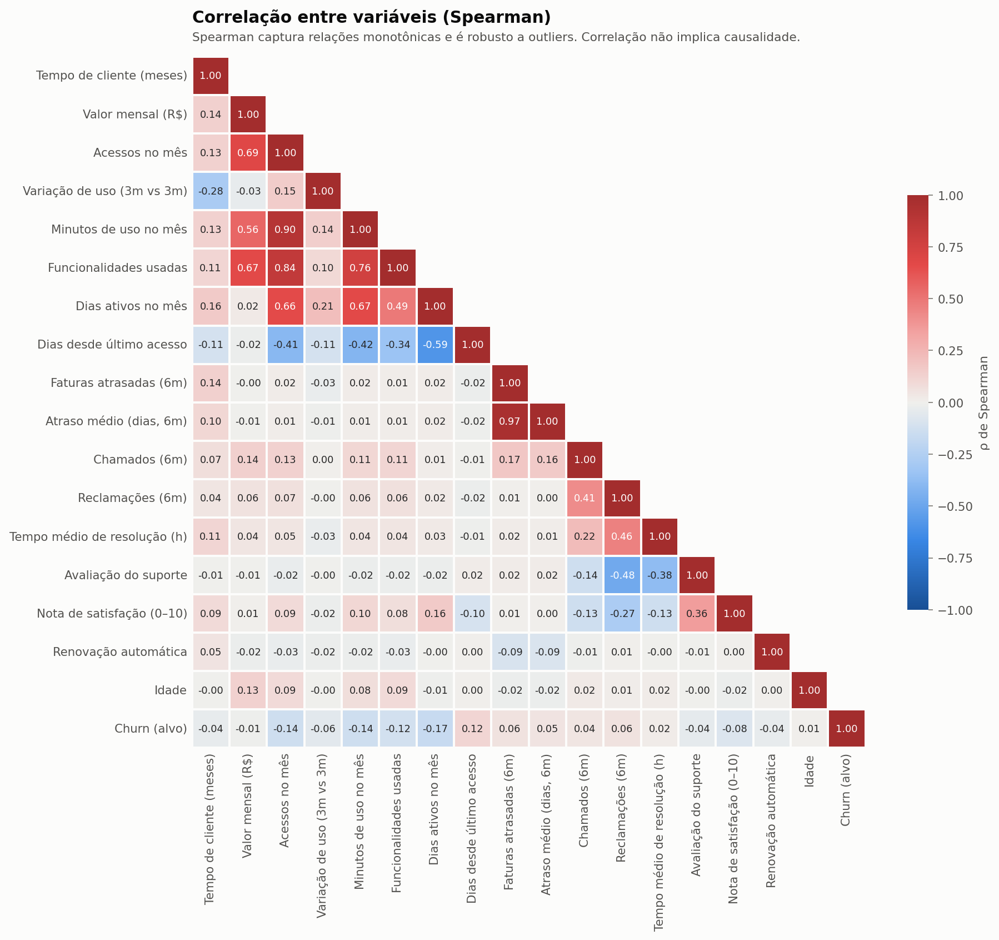

Correlação (Spearman) de cada variável com o churn, em ordem de magnitude:

| variável | ρ com churn |
|---|---:|
| Dias ativos no mês | -0,17 |
| Acessos no mês | -0,14 |
| Minutos de uso no mês | -0,14 |
| Funcionalidades usadas | -0,12 |
| Dias desde último acesso | 0,12 |
| Nota de satisfação (0–10) | -0,08 |
| Variação de uso (3m vs 3m) | -0,06 |
| Reclamações (6m) | 0,06 |
| Faturas atrasadas (6m) | 0,06 |
| Atraso médio (dias, 6m) | 0,05 |
| Avaliação do suporte | -0,04 |
| Chamados (6m) | 0,04 |
| Tempo de cliente (meses) | -0,04 |
| Renovação automática | -0,04 |
| Tempo médio de resolução (h) | 0,02 |
| Valor mensal (R$) | -0,01 |
| Idade | 0,01 |

Leituras importantes:
- As correlações individuais com o alvo são **fracas** (|ρ| < 0,2). Isso é típico de churn: nenhum fator isolado
  explica o cancelamento; é a **combinação** de sinais que importa — motivo para usar modelos multivariados.
- Há **multicolinearidade** entre variáveis de uso (acessos, minutos, dias ativos, funcionalidades). Para a Regressão
  Logística isso pede regularização; para árvores, é menos crítico.

## 7. Outliers

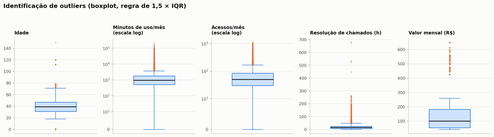

| variável | Q1 | Q3 | limite_inferior | limite_superior | outliers | outliers_% | máximo |
|---|---:|---:|---:|---:|---:|---:|---:|
| idade | 31,00 | 47,00 | 7,00 | 71,00 | 299 | 0,43 | 150,00 |
| minutos_uso_m1 | 510,00 | 1.797,25 | -1.420,88 | 3.728,12 | 5.801 | 8,15 | 230.359,00 |
| acessos_m1 | 30,00 | 85,00 | -52,50 | 167,50 | 5.373 | 7,55 | 1.096,00 |
| tempo_medio_resolucao_h_6m | 7,90 | 23,92 | -16,14 | 47,96 | 3.530 | 5,96 | 677,90 |
| valor_mensal | 54,39 | 181,81 | -136,74 | 372,94 | 5.974 | 8,39 | 648,92 |

- **Idade**: valores 0, 1, 112, 120 e 150 são erros de digitação → tratados como ausentes (validação de domínio).
- **Minutos de uso**: a cauda longa é esperada (clientes grandes), mas os valores extremos vêm de integrações
  automatizadas → winsorização no percentil 99 **do treino**.
- **Acessos e valor mensal**: outliers são clientes legítimos de planos maiores → mantidos; usaremos taxas
  relativas ao plano na engenharia de atributos.

## 8. Checagem de atributos sensíveis

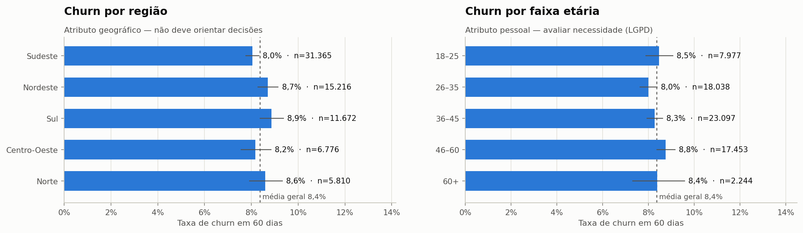

A taxa de churn por região varia entre 8,0% e 8,9%, com intervalos de confiança
sobrepostos — **sem diferença relevante**. O mesmo vale para idade. Como esses atributos não trazem sinal e têm
potencial discriminatório, a decisão (detalhada em `docs/lgpd.md`) é **não usá-los como entrada do modelo**,
mantendo-os apenas para auditoria de viés.

## 9. Principais conclusões para a modelagem

1. **Desbalanceamento** (~11:1) → métricas PR-AUC, Recall e Precision; estratégia de balanceamento avaliada só no treino.
2. **Dados temporais** → divisão treino/teste **por data de referência**, com intervalo de 60 dias entre os períodos.
3. **Queda de uso é o sinal mais forte** → atributos de tendência (variação, razão recente/anterior, recência).
4. **Uso depende do plano** → normalizar pela capacidade do plano (taxa de utilização de funcionalidades).
5. **Atrito financeiro e de suporte** somam risco → percentuais de atraso, reclamações e tickets por mês.
6. **Ausência carrega informação** → *flags* de ausência ("nunca abriu chamado", "não respondeu pesquisa").
7. **Vazamento**: `data_cancelamento`, `motivo_cancelamento` e `status` ficam fora dos atributos.
8. **Ética**: região e idade ficam fora do modelo; usadas apenas para auditoria.
