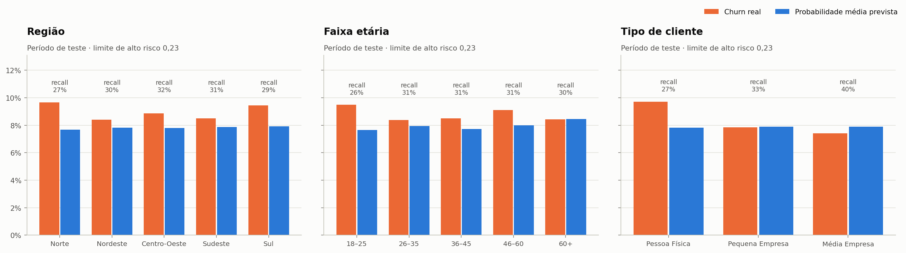

# Ética, privacidade e LGPD

> Este documento descreve como o ChurnGuard AI foi desenhado para usar IA de forma responsável e alinhada à
> **Lei Geral de Proteção de Dados (Lei nº 13.709/2018)**. É uma referência de engenharia para um projeto de
> portfólio, **não um parecer jurídico**: uma implantação real deve ser validada pelo encarregado de dados (DPO)
> e pela área jurídica da empresa.
>
> Todos os dados deste projeto são **sintéticos**. Nenhuma pessoa real está representada.

## 1. Princípios adotados

| Princípio | Como aparece no produto |
|---|---|
| **A IA estima, não afirma** | Toda saída é uma *probabilidade estimada de cancelamento*. A interface e a API nunca dizem "este cliente vai cancelar". |
| **Decisão humana** | O modelo sugere; a equipe decide e registra a ação (`retention_actions`). Nenhuma ação é disparada automaticamente. |
| **Explicação para cada previsão** | Fatores que aumentam e reduzem o risco, em linguagem de negócio (SHAP traduzido). |
| **Correlação não é causalidade** | Recomendações são hipóteses a validar (ex.: com grupo de controle). O aviso acompanha cada sugestão. |
| **Mínimo de dados necessários** | Só entram no modelo dados de relacionamento com o serviço (uso, pagamentos, suporte, contrato). |
| **Transparência sobre limitações** | Métricas reais (a maioria dos sinalizados não cancelaria), limitações e premissas publicadas na tela *Modelo*. |
| **Monitoramento contínuo** | Desempenho, calibração e drift acompanhados; re-treino com nova validação (ver `docs/monitoring.md`). |

## 2. Princípios da LGPD (art. 6º) na prática

| Princípio | Implementação |
|---|---|
| **Finalidade** | Dados usados para um fim específico e informado: prevenir cancelamentos e melhorar o atendimento. |
| **Adequação** | Os atributos têm relação direta com a finalidade (uso do produto, pagamentos, suporte). |
| **Necessidade** | Idade e região **não entram no modelo** (sem sinal na EDA); nome não é usado pelo modelo. Listagens não expõem idade. |
| **Livre acesso** | A API permite consultar, por cliente, a previsão, os fatores e o histórico — base para atender pedidos do titular. |
| **Qualidade dos dados** | Validação de domínio na ingestão (idades impossíveis → nulo, duplicatas removidas), `CHECK` constraints no banco. |
| **Transparência** | Explicação individual + documentação pública do modelo (`docs/model.md`). |
| **Segurança** | Chave de API, registro de acessos, banco não exposto, contêineres sem root, segredos fora do código. |
| **Prevenção** | Auditoria de viés, monitoramento de drift, testes automatizados contra vazamento de dados. |
| **Não discriminação** | Atributos pessoais fora do modelo e auditoria de desempenho por grupo (seção 5). |
| **Responsabilização** | Cada previsão guarda versão do modelo e dados usados; cada ação guarda responsável e resultado. |

## 3. Base legal, direitos e decisões automatizadas

- **Base legal sugerida:** *legítimo interesse* do controlador (art. 7º, IX) para análise de retenção de clientes
  com contrato ativo, acompanhado do teste de balanceamento previsto no art. 10 e de transparência ao titular
  (ex.: política de privacidade mencionando análises preditivas de relacionamento).
- **Dados sensíveis (art. 11):** o modelo **não utiliza** dados sensíveis (origem racial ou étnica, religião,
  opinião política, saúde, vida sexual, biometria etc.) nem atributos que os substituam de forma evidente.
- **Direitos do titular (art. 18):** confirmação, acesso, correção, anonimização, eliminação e informação sobre
  compartilhamento. A estrutura do banco (dados por `customer_id`) permite localizar e tratar todos os registros
  de um titular; a remoção em cascata está definida nas chaves estrangeiras.
- **Revisão de decisões automatizadas (art. 20):** o titular pode solicitar revisão de decisões tomadas unicamente
  com base em tratamento automatizado. O ChurnGuard AI **não toma decisões automatizadas sobre o cliente** — ele
  prioriza atenção interna — e toda previsão é explicável, o que também atende ao dever de fornecer informações
  sobre critérios e procedimentos.
- **Registro das operações (art. 37) e relatório de impacto (art. 38):** `predictions` (o que foi previsto, com
  quais dados, por qual versão), `retention_actions` e `access_log` fornecem a trilha para o registro de
  operações e subsidiam um eventual Relatório de Impacto à Proteção de Dados (RIPD).

## 4. Quais dados o modelo usa — e quais não

| Categoria | Usa? | Observação |
|---|---|---|
| Uso do produto (acessos, dias ativos, funcionalidades, tendências) | ✅ | Núcleo do modelo |
| Pagamentos (atrasos, faturas em aberto, forma de pagamento) | ✅ | Relacionamento financeiro com o serviço |
| Suporte e satisfação (chamados, reclamações, avaliações, NPS) | ✅ | Qualidade da experiência |
| Contrato e plano (tipo, renovação, valor, tempo de casa) | ✅ | Condições comerciais |
| Canal de aquisição, tipo de cliente | ✅ | Atributos do relacionamento, não da pessoa |
| **Idade** | ❌ | Atributo pessoal sem sinal preditivo; mantido só para auditoria de viés |
| **Região** | ❌ | Sem sinal preditivo; risco de discriminação geográfica; usado só como filtro e auditoria |
| **Nome** | ❌ | Exibição na interface para a equipe autorizada |
| `motivo_cancelamento`, `status`, `data_cancelamento` | ❌ | Informação posterior ao cancelamento (vazamento) |

A lista oficial é gerada pelo próprio pipeline (`EXCLUDED_COLUMNS` em `ml/src/features/build_features.py`) e
exibida na tela *Modelo* e em `GET /api/v1/model/info`.

## 5. Auditoria de viés

Mesmo sem idade e região como entrada, outras variáveis poderiam funcionar como *proxies*. A auditoria
(`python -m ml.src.evaluation.fairness`) compara, no período de teste, churn real, probabilidade média prevista e
recall por grupo.

| Grupo | Churn real | Prob. média | % alto risco | Recall |
|---|---:|---:|---:|---:|
| Norte | 9,7% | 7,7% | 7,3% | 27% |
| Nordeste | 8,4% | 7,8% | 7,7% | 30% |
| Centro-Oeste | 8,9% | 7,8% | 7,9% | 32% |
| Sudeste | 8,5% | 7,9% | 7,7% | 31% |
| Sul | 9,5% | 7,9% | 8,0% | 29% |
| 18–25 anos | 9,5% | 7,7% | 7,1% | 26% |
| 26–35 anos | 8,4% | 7,9% | 7,9% | 31% |
| 36–45 anos | 8,5% | 7,7% | 7,6% | 31% |
| 46–60 anos | 9,1% | 8,0% | 8,2% | 31% |
| 60+ anos | 8,4% | 8,5% | 8,8% | 30% |
| Pessoa Física | 9,7% | 7,8% | 7,4% | 27% |
| Pequena Empresa | 7,8% | 7,9% | 8,0% | 33% |
| Média Empresa | 7,4% | 7,9% | 8,8% | 40% |

**Leitura:**
- **Região e idade:** a proporção sinalizada varia pouco entre grupos (7,1%–8,8%) e o recall fica entre 26% e 32%.
  As diferenças são compatíveis com variação estatística; o grupo 60+ tem poucas observações (877) e deve ser
  acompanhado.
- **Tipo de cliente:** achado relevante — para **pessoas físicas** o modelo **subestima** o churn (prevê 7,8%, real
  9,7%) e encontra menos cancelamentos (recall 27% contra 40% em médias empresas). Parte da explicação é que
  pessoas físicas reagiram mais ao reajuste de 2026, efeito que o modelo aprendeu de forma incompleta.
  *Ação proposta:* incluir sensibilidade a preço no próximo treino, avaliar limites por segmento e manter este
  indicador no monitoramento.
- A auditoria é repetível e deve ser rodada a cada re-treino.

## 6. Segurança da informação (art. 46)

| Medida | Onde |
|---|---|
| Autenticação por chave de API (`X-API-Key`), comparação em tempo constante | `backend/app/core/security.py` |
| Chave mantida no servidor (Nginx injeta); o navegador nunca a recebe | `frontend/nginx.conf.template` |
| Registro de acesso a dados de clientes (usuário, ação, cliente, data) | tabela `access_log` |
| Banco publicado apenas em `127.0.0.1`; contêineres sem root | `docker-compose.yml`, Dockerfiles |
| Segredos em variáveis de ambiente; `.env` fora do Git | `.env.example`, `.gitignore` |
| Cabeçalhos de segurança HTTP (`nosniff`, `DENY` para frames, `Referrer-Policy`) | Nginx |
| CORS restrito e métodos HTTP limitados | `backend/app/main.py` |
| Identificador pseudonimizado (`CLI-00001`) separado dos dados de uso | modelo de dados |

**Recomendações para produção:** autenticação de usuários com SSO e perfis de acesso (ex.: analista vê apenas sua
carteira), TLS em todas as conexões, criptografia do banco em repouso, rotação de chaves, política de retenção
(ex.: previsões e registros de acesso por prazo definido) e anonimização dos dados usados em treino quando possível.

## 7. Limitações que o usuário precisa conhecer

- O modelo **prioriza**, não decide: com o limite atual, cerca de dois em cada três clientes sinalizados não
  cancelariam nos 60 dias seguintes.
- Probabilidades são estimativas calibradas no passado; mudanças de contexto (reajustes, concorrência, suporte)
  alteram a realidade — por isso o monitoramento.
- Recomendações são heurísticas baseadas no principal fator; seu efeito causal não foi medido.
- A simulação "e se" mostra a reação do modelo, não o comportamento futuro do cliente.

## 8. Checklist para uma implantação real

- [ ] Validar base legal e teste de legítimo interesse com o DPO
- [ ] Atualizar a política de privacidade (análises preditivas de relacionamento)
- [ ] Elaborar RIPD
- [ ] Definir perfis de acesso e prazos de retenção
- [ ] Rodar a auditoria de viés com dados reais antes do go-live e a cada re-treino
- [ ] Medir o efeito das ações de retenção com grupo de controle
- [ ] Definir canal para pedidos dos titulares (acesso, correção, eliminação, revisão)
