# Documentação do Modelo — ChurnGuard AI

> Gerado automaticamente por `python -m ml.src.evaluation.report` a partir dos artefatos de
> `python -m ml.src.training.train`. Versão do modelo: **1.0.0** · treinado em 2026-09-30T10:55:50.

## Resumo executivo

| Item | Valor |
|---|---|
| Pergunta | Probabilidade de o cliente **cancelar nos próximos 60 dias** |
| Modelo escolhido | **Gradient Boosting (HistGradientBoosting)** |
| Estratégia de desbalanceamento | **Nenhuma** (probabilidades calibradas + threshold ajustado) |
| ROC-AUC / PR-AUC no teste | **0,794** / **0,298** (taxa base 8,8%) |
| Threshold operacional | **0,23** (escolhido no treino, maximizando o resultado esperado) |
| No teste, com esse threshold | precision **34,2%** · recall **30,3%** · F1 0,321 |
| 10% de maior risco | churn real de **31,7%** (**3,6×** a média) |
| Abordando os 20% de maior risco | encontra **57%** dos cancelamentos |
| Níveis de risco | Baixo < 0,12 ≤ Médio < 0,23 ≤ Alto |
| Clientes ativos hoje | 4.184 · alto risco: **319** · médio: 520 |
| Receita mensal em alto risco | **R$ 45.346** |

---

## 1. Engenharia de atributos

Código: `ml/src/features/build_features.py`. Todas as transformações são **por linha e sem estado**
(usam apenas informações do próprio cliente naquela data de referência); por isso não há como vazar
informação entre treino e teste. Tudo o que depende da distribuição dos dados (limites de outlier,
medianas, padronização) é aprendido no pipeline, **só no treino**.

| Atributo | Como é calculado | Por que ajuda |
|---|---|---|
| `media_acessos_semana` | acessos do mês ÷ 4,33 | frequência em unidade intuitiva para o negócio |
| `taxa_utilizacao_funcionalidades` | funcionalidades usadas ÷ disponíveis no plano | normaliza o uso pela capacidade do plano (Empresarial tem 20 módulos, Básico 5) |
| `taxa_dias_ativos` | dias ativos ÷ 30 | hábito de uso, mais estável que contagem de acessos |
| `minutos_por_sessao` | minutos ÷ sessões | profundidade do uso |
| **`variacao_uso`** | média de acessos (3 últimos meses) ÷ média (3 anteriores) − 1 | **mudança de comportamento** — sinal central da EDA |
| **`variacao_uso_ultimo_mes`** | acessos do mês ÷ mês anterior − 1 | queda abrupta recente |
| **`tendencia_uso`** | inclinação da reta de acessos em 6 meses ÷ média | tendência de médio prazo, robusta a um mês atípico |
| **`meses_consecutivos_queda`** | meses seguidos com uso menor que o anterior | persistência da queda |
| `variacao_minutos` | minutos do mês ÷ mês anterior − 1 | queda de intensidade mesmo com acessos estáveis |
| `percentual_pagamentos_atrasados` | faturas atrasadas ÷ faturas (6 meses) | atrito financeiro relativo, comparável entre clientes novos e antigos |
| `tem_fatura_em_aberto` | fatura vencida há mais de 5 dias sem pagamento | risco de churn involuntário |
| `teve_reajuste_recente` / `reajuste_pct_6m` | variação da mensalidade em 6 meses | sensibilidade a preço (picos de churn pós-janeiro) |
| `relacao_tickets_por_mes` | chamados (6m) ÷ meses observados | volume de suporte normalizado pelo tempo de casa |
| **`aceleracao_tickets`** | chamados (3 últimos meses) − chamados (3 anteriores) | **aumento** de atrito com o suporte |
| `proporcao_reclamacoes` | reclamações ÷ chamados | qualidade da relação, não só volume |
| `tempo_desde_ultimo_chamado` | dias desde o último chamado (365 se nunca abriu) | recência do atrito |
| `nunca_abriu_chamado`, `sem_avaliacao_suporte`, `sem_pesquisa_satisfacao`, `historico_curto` | *flags* de ausência | ausência carrega informação (pouco relacionamento) |
| `cliente_novo` | até 3 meses de casa | janela de onboarding |
| **`meses_ate_renovacao`** / `renovacao_proxima` | meses até o aniversário do contrato anual (mensal = 1) | captura o "penhasco" de renovação visto na EDA |

**Atributos excluídos** e motivo:

| Coluna | Motivo |
|---|---|
| customer_id | identificador |
| nome | dado pessoal, sem valor preditivo |
| data_referencia | metadado temporal (usado só para dividir treino/teste) |
| idade | atributo pessoal sem sinal na EDA — mantido só para auditoria de viés (LGPD) |
| regiao | atributo geográfico sem sinal na EDA — mantido só para auditoria de viés |
| churn | variável-alvo |
| `data_cancelamento`, `motivo_cancelamento`, `status` | informação posterior ao evento — **vazamento** (não chegam à base analítica) |

## 2. Preparação dos dados

Código: `ml/src/preprocessing/pipeline.py`. Um único objeto `Pipeline` do scikit-learn, salvo com `joblib`,
é usado no treino, na avaliação e na API:

```text
FeatureEngineer (sem estado, seleciona só as colunas do modelo)
  → ColumnTransformer
       numéricas  : Winsorizer (p0,5–p99,5 do treino) → SimpleImputer(mediana) → StandardScaler*
       binárias   : SimpleImputer(moda)
       categóricas: SimpleImputer("Não informado") → OneHotEncoder(handle_unknown="ignore")
  → Modelo
* padronização só para a Regressão Logística (árvores não precisam)
```

### Divisão temporal

Os dados têm dinâmica temporal (picos pós-reajuste) e o mesmo cliente aparece em vários meses. Uma divisão
aleatória colocaria o "futuro" de um cliente no treino e o "passado" no teste. Por isso:

| Conjunto | Datas de referência | Linhas | Churn |
|---|---|---:|---:|
| Treino | 2024-06-30 → 2025-09-30 | 37.077 | 7,9% |
| *Intervalo* | out/2025 e nov/2025 descartados | — | — |
| Teste | 2025-12-31 → 2026-07-31 | 27.792 | 8,8% |

O intervalo de 2 meses existe porque o rótulo olha 60 dias à frente: o rótulo do último
mês de treino depende de eventos até o fim de novembro/2025.

**Validação cruzada temporal** (`TemporalGroupSplit`), usada no ajuste de hiperparâmetros, no estudo de
desbalanceamento e na escolha do threshold — sempre **dentro do treino**:

| Dobra | Treina até | Valida em |
|---:|---|---|
| 1 | 2024-10-31 | 2025-01-31 → 2025-03-31 |
| 2 | 2025-01-31 | 2025-04-30 → 2025-06-30 |
| 3 | 2025-04-30 | 2025-07-31 → 2025-09-30 |

## 3. Métricas: por que não acurácia?

Com 8,8% de churn no teste, um "modelo" que responde sempre *"não cancela"* teria
**91,2% de acurácia** — e não encontraria nenhum cliente em risco. Com o threshold
padrão de 0,50, o nosso modelo tem acurácia de 91,3%, mas recall de apenas 4,1%.

| Métrica | O que responde | Uso no projeto |
|---|---|---|
| **PR-AUC** | Quão bem o modelo acha churns sem gerar alarmes falsos, em todos os thresholds | **Métrica principal** de seleção |
| ROC-AUC | Quão bem o modelo ordena clientes por risco | Complementar |
| **Recall (churn)** | Dos clientes que cancelaram, quantos o modelo sinalizou? | Churn não detectado = retenção perdida |
| **Precision (churn)** | Dos clientes sinalizados, quantos cancelaram de fato? | Falso positivo = recurso de retenção desperdiçado |
| F1 | Equilíbrio entre os dois | Referência estatística do threshold |
| Brier score | Quão realistas são as probabilidades | Essencial, pois o produto **mostra** a probabilidade |

## 4. Modelos testados

| Modelo | CV PR-AUC (inicial → ajustado) | CV ROC-AUC | Teste PR-AUC | Teste ROC-AUC | Brier (teste) |
|---|---|---|---|---|---|
| Regressão Logística | 0,219 → **0,220** ± 0,019 | 0,761 | 0,249 | 0,770 | 0,0730 |
| Random Forest | 0,234 → **0,249** ± 0,003 | 0,779 | 0,273 | 0,783 | 0,0717 |
| Gradient Boosting (HistGradientBoosting) | 0,227 → **0,260** ± 0,008 | 0,783 | 0,298 | 0,794 | 0,0705 |

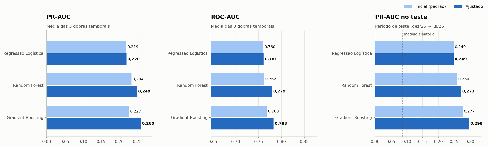
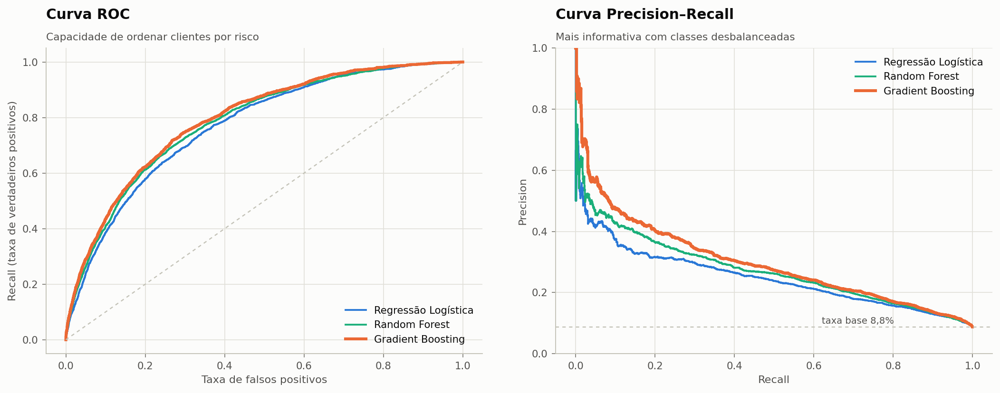

### Hiperparâmetros (RandomizedSearchCV, CV temporal, otimizando PR-AUC)

| Modelo | Hiperparâmetros escolhidos |
|---|---|
| Regressão Logística | `C=0,2538`, `l1_ratio=1,0000`, `solver=saga` |
| Random Forest | `max_depth=None`, `max_features=0,3000`, `min_samples_leaf=42`, `n_estimators=300` |
| Gradient Boosting (HistGradientBoosting) | `early_stopping=False`, `l2_regularization=3,5388`, `learning_rate=0,0411`, `max_features=0,4718`, `max_iter=280`, `max_leaf_nodes=8`, `min_samples_leaf=24` |

O que mudou e por quê:
- **Gradient Boosting**: árvores mais rasas (`max_leaf_nodes` pequeno), `min_samples_leaf` e regularização L2
  maiores e amostragem de atributos (`max_features`). Com sinal fraco e ruidoso (churn), modelos mais simples por
  árvore e mais regularizados generalizam melhor para o período seguinte.
- **Random Forest**: `min_samples_leaf` alto suaviza as probabilidades das folhas (menos sobreajuste a clientes
  específicos que aparecem em vários snapshots).
- **Regressão Logística**: regularização (L1/L2) quase não muda o resultado — o limite é a própria forma
  linear, que não captura interações (ex.: *contrato anual × meses até a renovação*).

### Modelo escolhido: Gradient Boosting (HistGradientBoosting)

- Maior PR-AUC média na validação cruzada (0,260 ± 0,008) e também no teste.
- Melhor calibração (menor Brier), importante porque o dashboard exibe a probabilidade.
- Captura interações e não-linearidades (o efeito da renovação só existe para contratos anuais).
- Rápido para treinar e pontuar; nativo do scikit-learn (sem dependência extra em produção).
- A explicabilidade é garantida com SHAP (`TreeExplainer`, exato para árvores).
- A Regressão Logística fica como **baseline interpretável** e confirma a direção dos efeitos (seção 8).

## 5. Desbalanceamento de classes

Proporção de ~12:1 no treino. As estratégias foram
comparadas **dentro de cada dobra** (o `Pipeline` do imbalanced-learn só reamostra no `fit`; validação e teste
nunca são reamostrados).

| Modelo | Estratégia | PR-AUC | ROC-AUC | Recall @0,5 | Precision @0,5 | Prob. média | Brier |
|---|---|---|---|---|---|---|---|
| Regressão Logística | Nenhuma | 0,219 | 0,760 | 2,5% | 37,3% | 8,2% | 0,0656 |
| Regressão Logística | class_weight='balanced' | 0,217 | 0,761 | 70,1% | 15,4% | 40,0% | 0,1987 |
| Regressão Logística | Random oversampling | 0,217 | 0,762 | 69,8% | 15,4% | 39,9% | 0,1978 |
| Regressão Logística | Random undersampling | 0,212 | 0,755 | 71,4% | 15,2% | 40,6% | 0,2054 |
| Regressão Logística | SMOTE | 0,217 | 0,759 | 70,6% | 15,4% | 38,8% | 0,1978 |
| Random Forest | Nenhuma | 0,234 | 0,762 | 1,4% | 45,7% | 9,2% | 0,0653 |
| Random Forest | class_weight='balanced' | 0,218 | 0,766 | 0,3% | 43,7% | 7,8% | 0,0653 |
| Random Forest | Random oversampling | 0,221 | 0,765 | 2,8% | 37,9% | 11,3% | 0,0675 |
| Random Forest | Random undersampling | 0,216 | 0,769 | 71,5% | 15,5% | 41,0% | 0,1940 |
| Random Forest | SMOTE | 0,221 | 0,761 | 3,8% | 41,5% | 12,4% | 0,0688 |
| Gradient Boosting (HistGradientBoosting) | Nenhuma | 0,227 | 0,768 | 6,0% | 41,2% | 7,5% | 0,0664 |
| Gradient Boosting (HistGradientBoosting) | class_weight='balanced' | 0,229 | 0,765 | 52,3% | 19,3% | 28,4% | 0,1383 |
| Gradient Boosting (HistGradientBoosting) | Random oversampling | 0,224 | 0,762 | 47,2% | 20,9% | 25,3% | 0,1230 |
| Gradient Boosting (HistGradientBoosting) | Random undersampling | 0,216 | 0,755 | 67,9% | 15,3% | 37,4% | 0,2051 |
| Gradient Boosting (HistGradientBoosting) | SMOTE | 0,240 | 0,772 | 7,6% | 42,2% | 8,6% | 0,0659 |

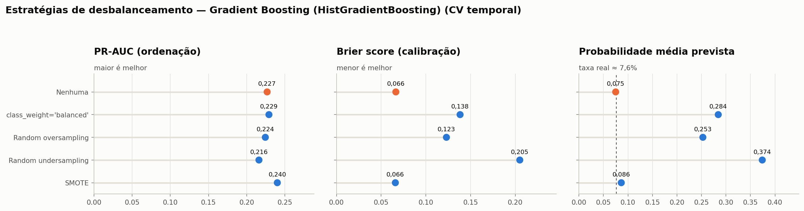

Verificação no modelo já ajustado:

| Estratégia (modelo ajustado) | PR-AUC | Brier | Prob. média |
|---|---|---|---|
| Nenhuma | 0,260 | 0,0639 | 8,1% |
| class_weight='balanced' | 0,251 | 0,1683 | 35,4% |
| SMOTE | 0,254 | 0,0655 | 10,6% |

**Decisão: Nenhuma.** O que os resultados mostram:
1. Nenhuma estratégia melhora a **ordenação** (PR-AUC/ROC-AUC) de forma consistente. O ganho do SMOTE no modelo
   com parâmetros padrão desaparece depois do ajuste de hiperparâmetros.
2. `class_weight` e reamostragem apenas **deslocam** as probabilidades para cima (probabilidade média de ~8% vai a
   25–40%), o que "melhora" o recall em 0,50 — mas o mesmo efeito se obtém baixando o threshold.
3. O custo é perder a **calibração** (Brier dobra): um cliente mostrado com "40%" teria, na realidade, ~10% de
   chance. Como o produto exibe a probabilidade para pessoas tomarem decisões, isso é inaceitável.

→ Tratamos o desbalanceamento na **decisão** (threshold), não nos dados.

## 6. Escolha do threshold

O threshold foi escolhido com previsões *out-of-fold* do **treino** (o teste não participa da escolha), pelo
critério de **maior resultado líquido esperado** da campanha de retenção:

> resultado = (churns abordados × mensalidade × 8 meses × 25% de sucesso) − (clientes abordados × R$ 50)

As premissas estão em `ml/src/config.py` (`BUSINESS`) e devem ser ajustadas à realidade de cada empresa.
Threshold escolhido: **0,23** (o que maximiza F1 seria 0,17).

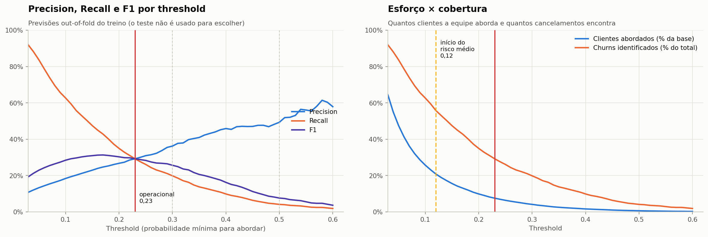
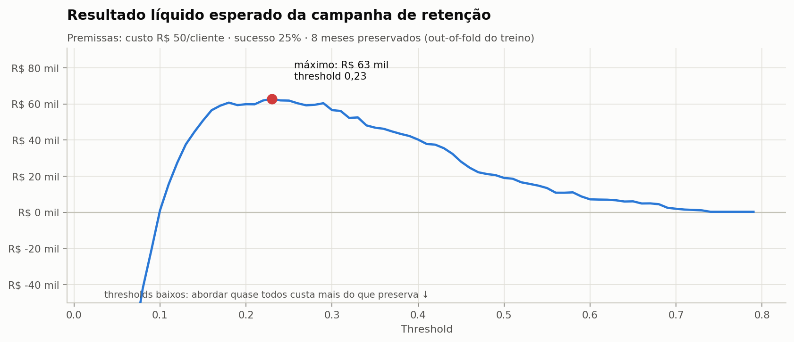

### Efeito do threshold no período de teste

| Threshold | Precision | Recall | F1 | Clientes abordados | % da base | Churns identificados | Falsos positivos | Resultado esperado |
|---|---|---|---|---|---|---|---|---|
| 0,10 | 22,6% | 63,1% | 0,333 | 6.787 | 24,4% | 1.535 de 2.434 | 5.252 | R$ 89.718 |
| 0,12 | 25,0% | 56,6% | 0,347 | 5.513 | 19,8% | 1.378 de 2.434 | 4.135 | R$ 111.092 |
| 0,20 | 31,9% | 35,9% | 0,338 | 2.735 | 9,8% | 873 de 2.434 | 1.862 | R$ 105.532 |
| **0,23** | 34,2% | 30,3% | 0,321 | 2.157 | 7,8% | 738 de 2.434 | 1.419 | R$ 97.988 |
| 0,30 | 40,9% | 19,6% | 0,265 | 1.170 | 4,2% | 478 de 2.434 | 692 | R$ 79.235 |
| 0,40 | 47,9% | 9,2% | 0,154 | 466 | 1,7% | 223 de 2.434 | 243 | R$ 47.176 |
| 0,50 | 57,1% | 4,1% | 0,077 | 175 | 0,6% | 100 de 2.434 | 75 | R$ 26.165 |
| 0,60 | 70,5% | 1,8% | 0,034 | 61 | 0,2% | 43 de 2.434 | 18 | R$ 14.034 |
| 0,70 | 87,5% | 0,6% | 0,011 | 16 | 0,1% | 14 de 2.434 | 2 | R$ 4.167 |

Leitura:
- **0,30** → aborda 4,2% da base e encontra 19,6% dos churns.
- **0,50** → quase ninguém é abordado: precision alta, mas 95,9% dos churns passam despercebidos.
- **0,70** → conservador demais para este problema.
- **0,23** (operacional) → equilíbrio entre esforço da equipe e cancelamentos evitados. O threshold é
  configurável na API e no dashboard.

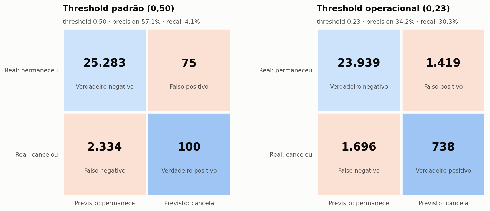

## 7. Níveis de risco

| Nível | Regra | Uso sugerido |
|---|---|---|
| 🟢 **Baixo** | probabilidade < 0,12 | sem ação; monitoramento |
| 🟡 **Médio** | 0,12 ≤ probabilidade < 0,23 | ações de engajamento em escala (e-mail, conteúdo) |
| 🔴 **Alto** | probabilidade ≥ 0,23 (threshold operacional) | contato humano prioritário |

O limite de **médio** é 1,5× a taxa média de churn do treino (arredondado): acima dele, o cliente já tem risco
claramente acima da média, mas ainda não justifica o custo de contato individual. Ambos os limites estão
salvos em `ml/models/model_metadata.json` e são configuráveis.

| Nível | Clientes | Churns | Taxa real de churn |
|---|---|---|---|
| Alto | 2.157 | 738 | 34,2% |
| Médio | 3.356 | 640 | 19,1% |
| Baixo | 22.279 | 1.056 | 4,7% |

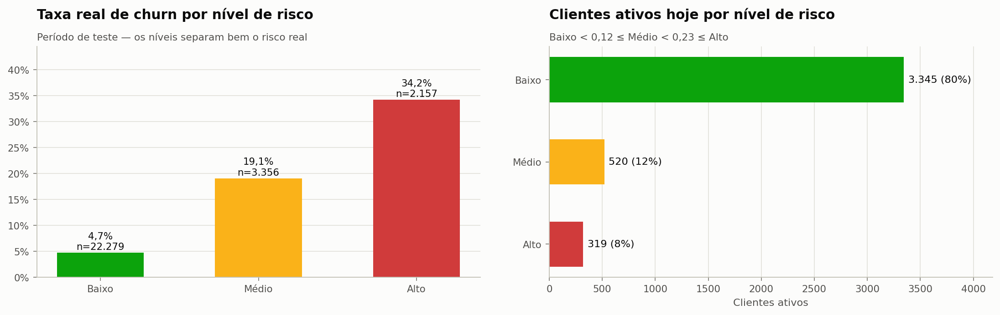
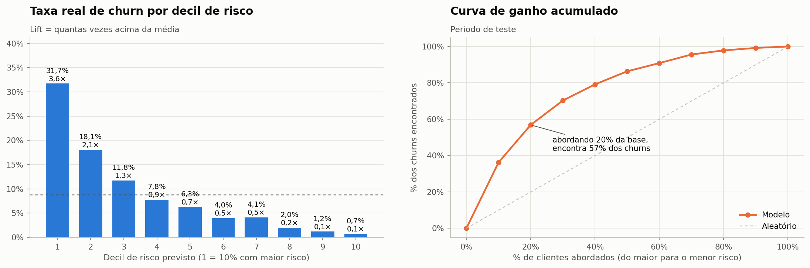
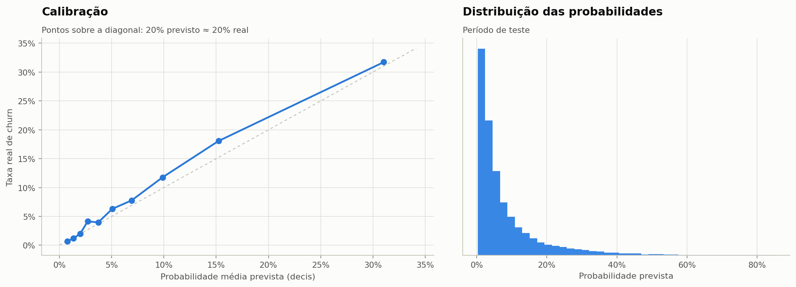

## 8. Explicabilidade

### Global — o que mais influencia o risco

| # | Fator | Importância (queda na PR-AUC) | Direção (SHAP) |
|---:|---|---|---|
| 1 | Janela de renovação do contrato | 0,1280 | ↓ valor alto reduz o risco |
| 2 | Dias ativos no mês | 0,0891 | ↓ valor alto reduz o risco |
| 3 | Forma de pagamento | 0,0087 | depende da categoria |
| 4 | Tempo como cliente | 0,0085 | ↓ valor alto reduz o risco |
| 5 | Variação de uso no último mês | 0,0076 | ↓ valor alto reduz o risco |
| 6 | Tipo de contrato | 0,0073 | depende da categoria |
| 7 | Nota de satisfação | 0,0064 | ↓ valor alto reduz o risco |
| 8 | Tempo desde o último chamado | 0,0057 | ↓ valor alto reduz o risco |
| 9 | Uso das funcionalidades do plano | 0,0047 | ↓ valor alto reduz o risco |
| 10 | Variação do tempo de uso | 0,0037 | efeito não linear |

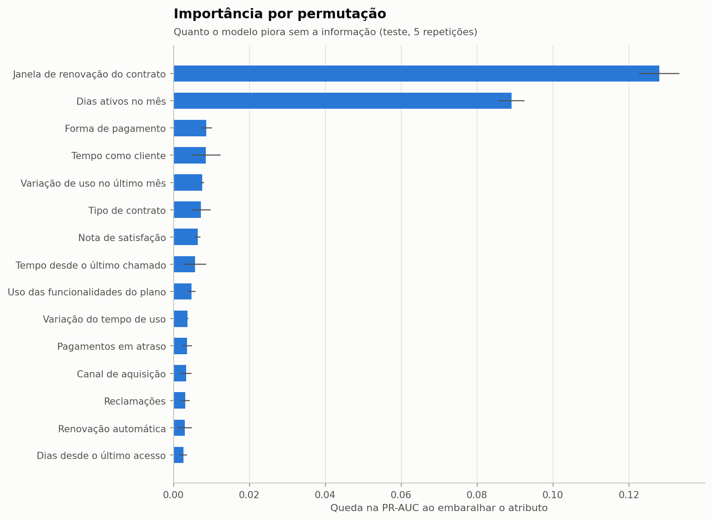
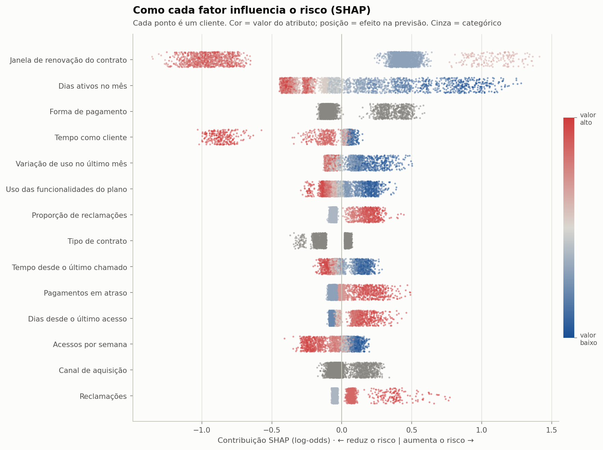

Leitura para o negócio:
- **Janela de renovação** é o fator mais forte: clientes mensais podem sair a qualquer momento, e clientes
  anuais concentram a saída perto do aniversário do contrato. *Ação: conversa de renovação antecipada.*
- **Hábito de uso** (dias ativos, funcionalidades usadas, frequência) vem logo depois, e **queda recente de uso**
  aparece entre os principais sinais. *Clientes não cancelam do nada; o uso cai antes.*
- **Atrito** — reclamações, atraso de pagamento, boleto sem renovação automática, nota de satisfação baixa — soma risco.
- **Correlação não é causalidade:** o modelo aprende associações. "Boleto" não *causa* churn; ele pode indicar
  menor compromisso ou mais fricção de pagamento. Recomendações devem ser testadas (ex.: teste A/B).

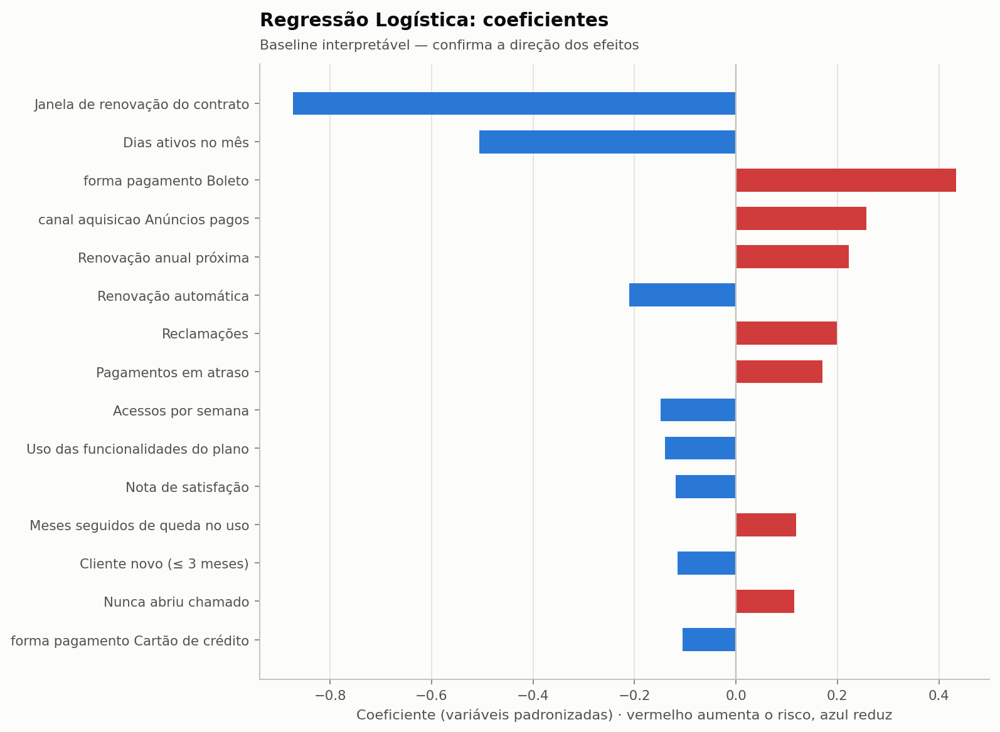

### Individual — por cliente

Cada previsão traz os principais fatores **em linguagem de negócio**, calculados com SHAP e convertidos por
templates (`ml/src/explainability/explainer.py`). Fatores estruturais (perfil, canal, contrato mensal) continuam
visíveis, mas o **principal fator** e a **recomendação** priorizam o que a empresa pode influenciar.

**Exemplo real da base atual — cliente `CLI-07443`**

| | |
|---|---|
| Probabilidade estimada de cancelamento (60 dias) | **70%** |
| Classificação | **Alto risco** |
| Principal fator | renovação do contrato anual em 2 meses |

Fatores que aumentam o risco:
- renovação do contrato anual em 2 meses
- ativo em apenas 10 dias no último mês
- pagamento via boleto
- nota de satisfação 5/10

Fatores que reduzem o risco:
- Tipo de contrato: Anual
- Canal de aquisição: Orgânico
- Renovação automática: Sim

**Sugestão:** *Iniciar conversa de renovação com antecedência, mostrando resultados obtidos com o produto.*

Prioridade alta — sugerido contato humano em até 48h.

> Sugestão baseada em padrões dos dados. A decisão final é da equipe responsável.

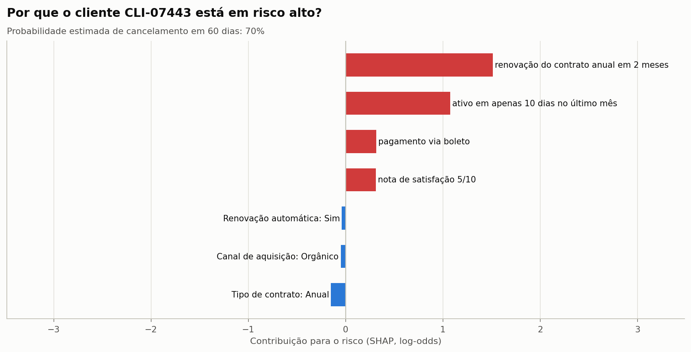

Categoria principal entre os clientes em **alto risco** hoje: utilização (202), contrato (71), financeiro (23), suporte e satisfação (23).

## 9. Resultado esperado no período de teste

Com o threshold operacional, a campanha teria abordado **2.157** clientes-mês
(7,8% das observações), encontrado **738** dos
2.434 cancelamentos e gerado resultado líquido esperado de **R$ 97.988**
(receita preservada R$ 205.838 − custo R$ 107.850), sob as
premissas acima.

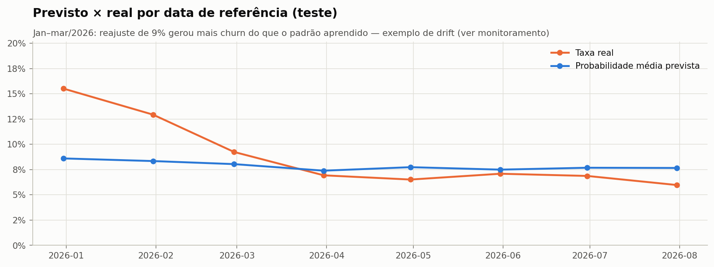

## 10. Modelo de produção

Depois da avaliação, o mesmo pipeline (mesmos hiperparâmetros e thresholds) é **re-treinado com todos os
snapshots rotulados** (2024-06-30 → 2026-07-31, 71.176 linhas)
para aproveitar os dados mais recentes. Os números de desempenho reportados são os do teste (modelo treinado só
até set/2025), que é a estimativa honesta do comportamento no futuro.

| Artefato | Conteúdo |
|---|---|
| `ml/models/churn_model.joblib` | pipeline de produção + metadados + amostra de referência |
| `ml/models/churn_model_eval.joblib` | pipeline avaliado no teste (auditoria) |
| `ml/models/model_metadata.json` | versão, parâmetros, thresholds, métricas, premissas |
| `ml/data/processed/scored_customers.parquet` | clientes ativos com probabilidade, risco, fatores e sugestão |
| `ml/data/processed/test_predictions.parquet` | previsto × real no teste (base do monitoramento) |

## 11. Limitações

- Dados **sintéticos**: os números demonstram o método; em dados reais o desempenho será diferente.
- PR-AUC de 0,298 significa que **a maioria dos sinalizados não cancelaria** — o modelo prioriza, não decide.
- Premissas financeiras (custo, sucesso, meses preservados) são hipóteses; o threshold deve ser revisto com dados reais de campanha.
- O modelo aprende **correlações**; efeito causal das ações deve ser medido com grupo de controle.
- Relações mudam com o tempo (novo reajuste, mudança no suporte) → monitoramento e re-treino (ver `docs/monitoring.md`).
