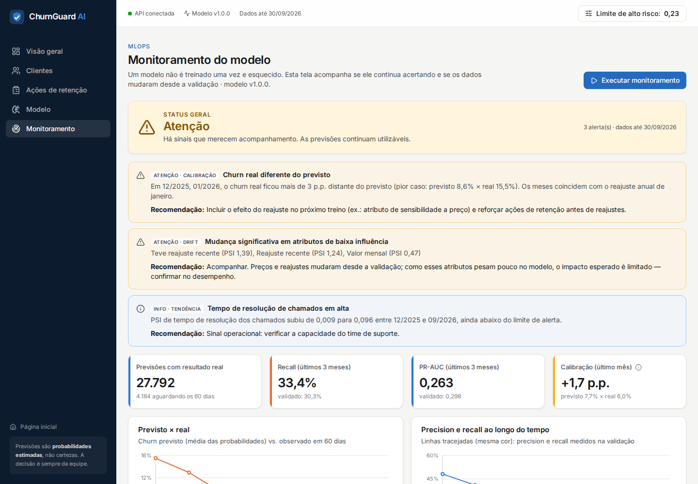

# Monitoramento do modelo

> Um modelo de Machine Learning **não é treinado uma única vez e esquecido**. Clientes mudam de comportamento,
> preços são reajustados, a operação de suporte muda — e as relações que o modelo aprendeu podem deixar de valer.



## 1. O que é acompanhado

| Dimensão | Pergunta | Como é medido | Fonte |
|---|---|---|---|
| **Desempenho** | O modelo continua encontrando quem cancela? | Precision, recall, F1, ROC-AUC, PR-AUC por data de referência | Previsões com resultado real (`predictions.churn_real`) |
| **Erros** | Quantos alertas falsos e quantos cancelamentos perdidos? | Falsos positivos e falsos negativos por mês | `v_prediction_outcomes` |
| **Calibração** | "8% previsto" continua significando ~8% real? | Churn previsto (média das probabilidades) − churn real | Idem |
| **Data drift** | Os dados de entrada mudaram desde a validação? | PSI por atributo, cruzado com a importância do atributo | `predictions.entrada` × `ml/models/reference_profile.json` |
| **Volume e distribuição** | Quantas previsões e quanto risco? | Contagem por data/origem, probabilidade média, % em alto risco | `predictions` |

O resultado real só é conhecido **60 dias depois** de cada previsão. O job `update_outcomes` registra esse
resultado automaticamente; por isso o desempenho sempre "olha para trás", enquanto o drift é o **alerta antecipado**.

## 2. Data drift com PSI

O **Population Stability Index** compara a distribuição de um atributo agora com a distribuição de referência:

```text
PSI = Σ (atual_i − referência_i) × ln(atual_i / referência_i)
```

- **Referência:** dados de treino do modelo validado (snapshots jun/2024 → set/2025), em `ml/models/reference_profile.json`.
- **Faixas:** decis da referência para atributos contínuos; frequências para categóricos e atributos com poucos valores distintos.
- **Ausentes** entram como uma faixa própria (mudança na taxa de preenchimento também é drift).

| PSI | Interpretação |
|---|---|
| < 0,10 | estável |
| 0,10 – 0,25 | mudança moderada — investigar |
| ≥ 0,25 | mudança significativa — avaliar re-treino |

**Drift ≠ modelo pior.** Por isso o PSI é cruzado com a **importância** do atributo (top 10 por permutação) e com o
desempenho observado.

## 3. Política de alertas

| Regra | Nível |
|---|---|
| Recall médio dos últimos 3 meses > 20% abaixo do validado | 🔴 crítico |
| PR-AUC médio dos últimos 3 meses > 20% abaixo do validado | 🔴 crítico |
| PSI ≥ 0,25 em atributo do top 10 de importância | 🔴 crítico |
| PSI ≥ 0,25 em atributo de baixa influência | 🟡 atenção |
| PSI entre 0,10 e 0,25 em atributo importante | 🟡 atenção |
| \|churn previsto − real\| > 3 p.p. em algum mês | 🟡 atenção |
| Tendência de alta consistente no PSI de um sinal operacional | ℹ️ informativo |

Os limites estão em `backend/app/services/monitoring.py` (`POLICY`) e são expostos pela API.

## 4. O que o monitoramento encontrou (dados do projeto)

Status atual: **🟡 Atenção** — as previsões continuam utilizáveis, com três pontos de acompanhamento:

1. **Calibração após o reajuste de janeiro/2026.** Em dez/2025 e jan/2026, o modelo previu ~8,5% de churn e o real
   foi 15,5% e 12,9%. O reajuste de 9% foi maior que os anteriores (5–7%) e gerou mais cancelamentos do que o padrão
   aprendido. *Ação:* incluir o efeito do reajuste de forma mais explícita no próximo treino e reforçar a retenção
   antes de reajustes.
2. **Drift em preço** (PSI 0,47 no valor mensal; reajuste recente com valor nunca visto na referência). Esperado:
   os preços subiram. Como esses atributos têm baixa importância no modelo, o desempenho não caiu — recall dos
   últimos 3 meses (33%) está acima do validado (30%).
3. **Tempo de resolução de chamados em alta** (PSI de 0,009 → 0,096 desde dez/2025, ainda "estável"). É um drift
   **operacional** injetado de propósito na simulação (suporte 35% mais lento desde mar/2026): o monitoramento
   o detecta antes que ele cruze o limite de alerta.

## 5. Rotina operacional

```bash
# Diariamente (cron, agendador do orquestrador, GitHub Actions…)
python -m backend.app.jobs.update_outcomes   # 1. registra o resultado real das previsões vencidas
python -m backend.app.jobs.score_customers   # 2. pontua a carteira atual com o modelo ativo
python -m backend.app.jobs.monitor           # 3. avalia desempenho, drift e grava em monitoring_runs

# Com Docker
docker compose --profile jobs run --rm jobs
```

`monitor` termina com **código de saída 2** quando o status é crítico, o que permite disparar notificações no
agendador ou falhar um pipeline.

## 6. Política de re-treino

1. **Gatilhos:** alerta crítico, ou a cada 6 meses, ou mudança de produto/preço relevante conhecida.
2. **Como:** `python -m ml.src.training.train` com os dados mais recentes — mesma divisão temporal, mesma validação.
3. **Critério de troca:** a nova versão só é ativada se superar a atual no período de teste mais recente
   (PR-AUC e calibração) — registrada em `model_versions`, com índice único garantindo uma única versão ativa.
4. **Rastreabilidade:** cada previsão guarda `model_version` e os atributos de entrada; cada execução do
   monitoramento fica em `monitoring_runs`.

## 7. Endpoints

| Método | Rota | Descrição |
|---|---|---|
| `GET` | `/api/v1/monitoring/summary` | Status, alertas, desempenho mensal, drift atual e temporal |
| `POST` | `/api/v1/monitoring/run` | Executa e grava uma execução |
| `GET` | `/api/v1/monitoring/runs` | Histórico de execuções |
